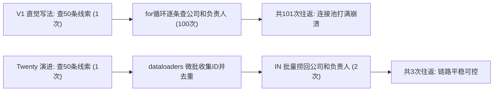
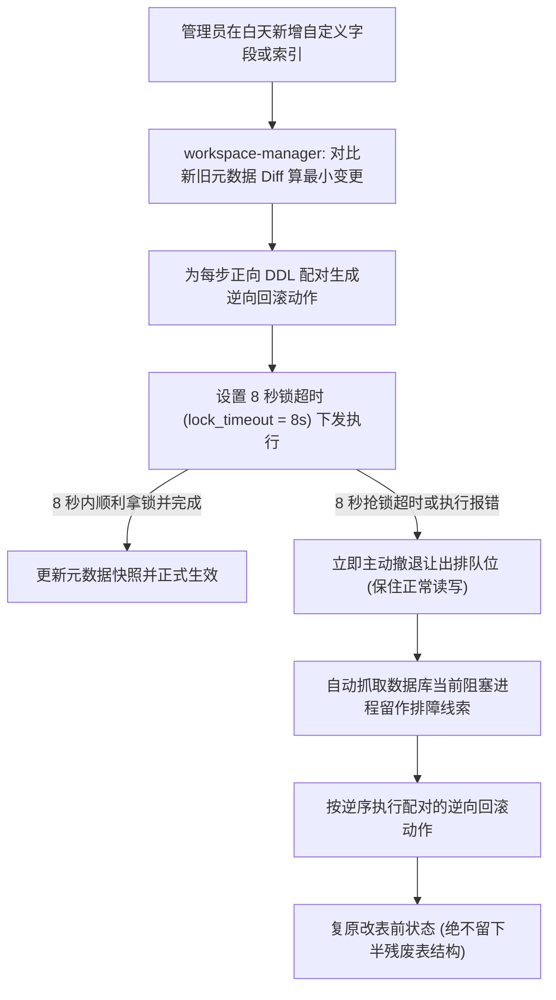
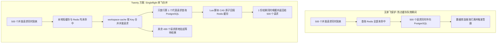
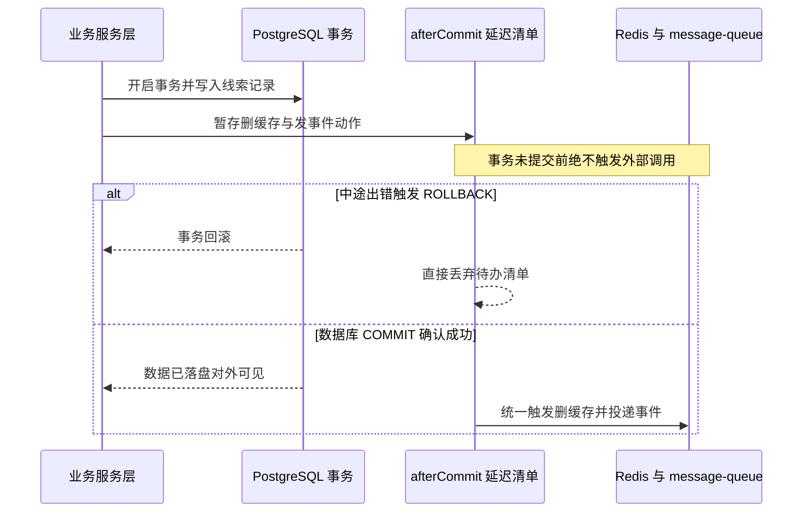
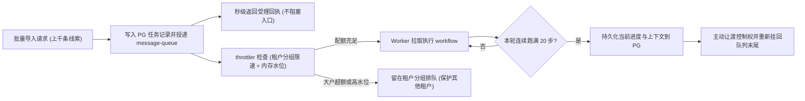
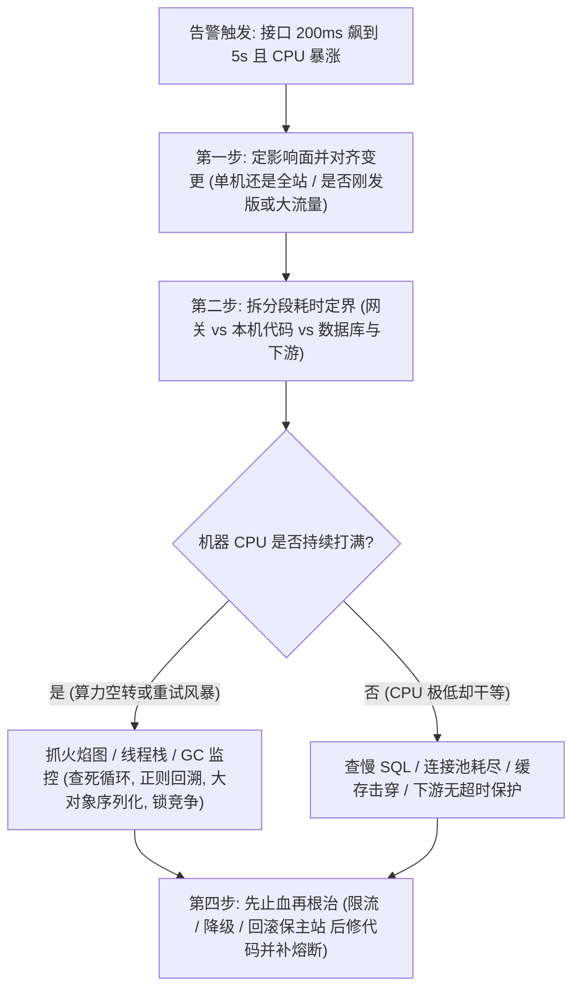

# 教程 02 · 后端核心链路与瓶颈演进（第二阶：再瓶颈演进）

> **阶段定位**：**再瓶颈演进**（全套教程三阶中的第二阶，核心主力篇，约占整体后端学习精力的 50%）  
> **适用岗位**：后端开发岗（含后端 × Agent 共享基础设施底座；**彻底跳过前端与全栈内容**）  
> **前置衔接**：先读完 [教程 01 · 业务全貌与学习剪枝地图](教程01-业务全貌与学习剪枝地图.md)，记住“销售小王录入大客户线索”前 3 站流转后再读本篇效果最佳。  
> **配套底座**：[大纲 02](../教程大纲/大纲02-后端核心链路与瓶颈演进.md) ｜ [面经种子库](../面经种子库/README.md) ｜ [ASu 训练种子](../面经种子库/asu-training-seed.md)

---

## 开篇导读：为什么后端要按“瓶颈演进”来学？

真实面试里，面试官最怕遇到两种候选人：  
一种是**直接背成品答案**：上来就念“我们用了 Schema 隔离、Singleflight、Lua 脚本、BullMQ”。只要面试官追问一句“为什么不直接用一个库加 `tenant_id`？”或“没有单飞之前会怎么炸？”，立刻语塞。  
另一种是**对着代码报菜名**：背了十几个文件名，却说不出业务请求进来之后先撞谁、后过谁、哪里最容易堵死。

所以整本《教程 02》的每一节都只干一件事——带你**从“新手最直觉的 V1 写法”出发，亲眼看着它在高并发和多租户压力下怎么一步步崩溃，然后再看 Twenty CRM 底座是怎么用一环扣一环的机制把漏洞堵住的**。只要顺着这条“痛点 → 崩溃 → 演进 → 三层追问”的逻辑链走下来，你根本不需要死记硬背。

### 本篇 8 节瓶颈演进全景导览

| 能力模块 | 节号与主题 | 对应业务主线 | 解决的核心瓶颈（一句话大白话） | 锚定 2026 真题 |
| :--- | :--- | :--- | :--- | :--- |
| **模块 1** | **第 1 节：多租户隔离演进** | 主线第 1 站 | 几千家企业“同楼不同房”，防串库又不打爆连接池 | `B06` `B07` `A10` |
| **模块 1** | **第 2 节：业务本体与权限建模** | 主线第 1 站 | 客户随时加字段，且绝不让业务和 AI 直捅数据库裸表 | `B03` `A10` |
| **模块 1** | **第 3 节：查询性能演进（PG vs MySQL）** | 主线第 1 站 | 消除 1 变 101 的 N+1 查询，拆穿内存红黑树反常识陷阱 | `B01` `B05` `B07` `B09` |
| **模块 1** | **第 4 节：线上改表安全演进** | 主线第 2 站 | 业务高峰期动态加字段，8 秒锁超时 + 逆向回滚保不锁站 | `B06` `B07` |
| **模块 2** | **第 5 节：缓存架构演进** | 主线第 2 站 | 本地短缓存 + Redis Hash + 单飞 + Lua 原子替换，拆解 10 分钟脏缓存 5 大元凶 | `B01` `B04` `B08` `B09` |
| **模块 2** | **第 6 节：事务与副作用一致性** | 主线第 2 站 | 事务没提交绝不提前删缓存或发消息（`afterCommit` vs 本地消息表） | `B04` `B06` |
| **模块 2** | **第 7 节：异步队列与长任务演进** | 主线第 3 站 | 限流分组防大户堵死、20 步让渡防霸占，横跨 Kafka 位点与无 MQ 状态机 | `B05` `B08` `B10` `A03` |
| **模块 2** | **第 8 节：下游超时回查与排障生存课** | 主线第 3 站 | 超时先查后重不盲重放，线上 200ms 飙 5s + CPU 暴涨四步救火 | `B02` `B04` `B10` |

> **事实边界再次提醒**：本篇拆解的 `twenty-orm`、`workspace-datasource`、`object-metadata`、`workspace-manager`、`workspace-cache`、`message-queue`、`workflow` 等均属于 Twenty 开源底座原生设计；文中对照补充的 **MySQL InnoDB、Kafka 位点机制、ClickHouse、本地消息表、无 MQ 纯数据库异步设计** 用于覆盖大厂通用后端真题，均明确标明**非 Twenty 仓库自带**；所有未实测的 QPS、命中率与 P99 耗时统一标为 **`待确认`**，严禁上场胡编数字。

---

## 能力模块 1：多租户存储、业务本体建模与线上安全变更的瓶颈演进

### 第 1 节：多租户隔离演进 —— 从“混住一表”到“Schema 隔离 + 共享主从连接池”

#### 1. 生活化痛点与主线站位

回到《教程 01》第 1 站的业务现场：早上九点，销售小王刚拜访完一位客户，打开 CRM 点下提交，录入了“某新能源大客户”的跟进线索。看似只是一个简单的保存动作，但站在平台后端视角，此刻同一台服务器后面正同时住着三千家互为竞争对手的企业——隔壁做同样生意的公司也在同一秒录入线索。

这就立刻撞上了企业级 SaaS 后端最核心的一对矛盾：**“绝对不能串门”与“绝不能浪费钱把数据库压垮”**。你可以把整套数据库想象成一栋商业写字楼：一方面，小王公司的大客户名单是核心商业机密，绝不允许隔壁公司哪怕在系统出错时瞄到一眼；另一方面，每家公司如果都单独修一栋楼、单独牵一套水电和宽带，三千家公司就能把物业（数据库服务器）的连接资源瞬间拖垮。多租户隔离架构的演进，本质上就是在“隔离安全性”、“自定义灵活性”和“连接资源复用率”之间找最划算的平衡点。

#### 2. 新手直觉 V1 写法 → 上量后怎么崩？

刚接触多租户的新手，往往会依次走过两条看似直观、上量后却必崩无疑的老路：

- **V1 直觉写法：合租大通铺（所有租户混住一张表 + `tenant_id` 字段）**
  - *怎么写*：建一张统一的 `lead` 线索表，所有公司的数据全塞进去，只在每行多加一列 `tenant_id` 标记“这条线索归谁”。每次查询、修改、删除都在代码里顺手拼一句 `WHERE tenant_id = 当前公司`。
  - *上量后怎么崩*：第一是**“一次手抖，全盘泄露”**——业务越做越复杂后，只要某天某位同学在多表关联或批量导出时漏写了这一行过滤条件，小王录的大客户线索就会直接出现在竞争对手的列表里，酿成 P0 级数据泄露事故；第二是**“嘈杂邻居效应”**——所有公司挤在一张几千万行的大表里，某家大客户早上批量导十万条线索把锁和磁盘 IO 吃满，其余几千家小微企业的查询跟着一起卡死；第三是**无法一户一改**——如果甲公司想在表里多加三个自定义字段，乙公司想加五个字段，混住一张表几乎没法安全扩展。
- **V2 粗暴升级：独栋小别墅（一户一个独立物理数据库 + 独立连接池）**
  - *怎么写*：既然合租太危险，干脆每入驻一家新公司，后台就自动给它单独新建一个物理数据库实例或独立连接池，物理上彻底断开。
  - *上量后怎么崩*：测试环境只有 5 个账号时稳如泰山，一旦商业化上量到 3,000 家企业，灾难就来了。哪怕每家公司只保留极小的 5 个连接池名额，后端也需要维持 `3,000 × 5 = 15,000` 个活跃长连接。PostgreSQL 每个连接都会吃掉独立的后端进程与内存，数据库的连接上限和内存当场就会被直接炸穿；更冤枉的是，大多数中小公司每天只点几十下，99% 的数据库连接都在空转占位。

#### 3. Twenty 的工业级演进方案（逻辑链 + 模块路标）

为了同时解决“合租不安全”和“独栋太烧钱”，Twenty 底座采用了**“精装独立套间 + 共享大楼管网”**的演进架构：**同库内按租户切分 PostgreSQL Schema + 全局共享主从物理连接池 + 请求链路 `AsyncLocalStorage` 上下文透传 + 表结构缓存**（核心逻辑收口在顶层模块 `workspace-datasource` 与 `twenty-orm` 中）。

整条数据流转链路像极了现代化的共享智能办公楼，分四步完成小王那条线索的安全入库：

1. **物理分间不混住（同库多 Schema 隔离）**：Twenty 不把所有客户混在一张大表里，也不给每家建独立物理库，而是在同一个 PostgreSQL 数据库内部，为每个工作区开辟独立的 **Schema（命名空间）**。小王所属的 A 公司拥有 `workspace_a` 套间，里面有自己的 `lead` 表；B 公司拥有 `workspace_b` 套间，里面也有一张同名但物理隔离的 `lead` 表。哪怕某条 SQL 忘记带租户过滤条件，它也只能撞在自己套间的墙上，绝对越不过隔壁门框；同时 A 公司可以放心地给自己的表加字段、建索引，完全不影响 B 公司。
2. **集中管网复用（全局共享主从连接池）**：`workspace-datasource` 模块在后端服务启动时，只维护一套全局共享的主库（负责写）和从库（负责读）物理连接池。无论平台入驻 100 家还是 5,000 家企业，后端跟数据库建立的物理连接总量只取决于当前的真实并发请求量，彻底告别“来一家公司多占五个闲置连接”的窘境。
3. **无感门禁卡透传（`AsyncLocalStorage` 请求上下文）**：小王发起“录入线索”请求时，网关一完成身份校验，就会把“当前请求属于 A 公司、对应哪一套 Schema 和权限环境”存进 Node.js 的 `AsyncLocalStorage` 异步上下文容器里。这就像给小王发了一张贯穿本次请求全程的隐形门禁卡：哪怕后面要经过七八层业务服务和校验模块，代码里都不用把 `workspaceId` 当成接力棒在每个函数参数里传来传去，任何下游环节随时一伸手就能精准拿到当前租户身份。
4. **刷卡借管与热缓存直达（`twenty-orm` 动态映射）**：真正准备写库时，`twenty-orm` 先从共享连接池里借出一根空闲物理连接，读取门禁卡上的租户标识，直接将 SQL 操作的目标 Schema 严格锁定在 A 公司的专属房间，并从元数据缓存里直接取出早已拼好的“A 公司当前表结构定义”（不用每次请求都现查系统表现拼），写完后立刻将物理连接干净归还回共享池。

#### 4. 横向补齐与工程取舍边界

在通用后端面试和选型对比中，除了上述方案，还经常被拿来横向比较的是 **PostgreSQL 行级安全策略（RLS，用于横向对比与通用后端面试应对，非 Twenty 主数据隔离方案）** 与 **独立物理实例分库**。如果业务极其简单、各家租户字段完全一模一样且永久不需要动态加列，数据库自带的 RLS 可以由数据库引擎强制在单表内追加租户过滤，避免人工漏写 `WHERE`；但只要你的产品像 CRM 一样允许客户自定义字段和索引，单表 RLS 立刻捉襟见肘，必须走向多 Schema 或分库。

同时必须清醒看到 Twenty 方案的**成本与扩展边界**：同库多 Schema 共享池虽然把几千家中小租户的硬件成本压到了极低，但它把压力留给了单库元数据规模——单台 PostgreSQL 里如果塞进几万个 Schema、上百万张独立表，数据库自身的系统目录表（Catalog）膨胀、内存表缓存开销以及全库备份恢复耗时都会急剧攀升。对于极少数对物理隔离合规或吞吐有极端要求的头部大客户，或者未来租户数继续向数万乃至十万级迈进时，依然需要外置物理分库路由。另外，本文涉及的连接池吞吐上限与具体 P99 耗时改善幅度，在个人未亲自搭建压测基线前统一标为 **`待确认`**，绝不拍脑袋编造压测数字。

#### 5. 2026 真实面试三层追问

- **L1 原理与机制（锚定 `B06` `B07`）**
  - **考官真问**：“多租户数据隔离常见有共享表加 `tenant_id`、同库分 Schema、独立物理库三种，你们了解的项目为什么选 Schema 隔离？”
  - **答题核心逻辑链**：用“安全性 + 扩展自由度 + 资源成本”三点递进回答。共享表最大问题是业务侧一旦漏写过滤条件就跨租户泄露，且各家不能独立加自定义字段；一户一物理库虽然绝对隔离，但几千个租户就会把数据库连接池和内存吃爆；Twenty 底座采用的 PG 同库多 Schema + 共享连接池，既让每家企业拥有独立的表结构空间，又让所有企业共用一套物理连接池，在安全隔离、租户自定义扩展和服务器成本之间取得了最佳平衡。
- **L2 反事实与极端故障（锚定 `B06` `A10`）**
  - **考官真问**：“几千家公司共享同一个数据库连接池，并发访问时，怎么保证上一个人用完的连接还回去后，下一个人借走不会串到上一个租户的 Schema 里？”
  - **答题核心逻辑链**：拆成“请求线程内隔离”和“数据库会话隔离”两道锁来答。第一，请求上下文采用 `AsyncLocalStorage` 按单次请求异步链隔离，严禁把租户 ID 存进全局单例变量或跨请求共享对象，杜绝内存层串号；第二，在连接使用层，最安全的做法是不依赖连接上残留的默认状态——`twenty-orm` 在生成查询与操作时显式指定带租户 Schema 前缀的目标表，或者在借出、归还连接的生命周期里强制清理并重置会话参数，同时严禁跨请求持有未关闭的事务，哪怕前一个请求中途报错崩掉，下一个请求借到这根连接时也绝不会读到上一任的残留状态。
- **L3 取舍边界与诚实防雷（锚定 `B07` 系统扩展性边界）**
  - **考官真问**：“如果公司入驻规模继续涨到十万级，单库几万个 Schema 会暴露什么新瓶颈？真到了这一步怎么演进？”
  - **答题核心逻辑链**：先坦诚不盲吹“Schema 隔离能扛无限租户”。当单库 Schema 膨胀到数万级时，PostgreSQL 内部系统目录表会变得极其庞大，导致查询规划器解析变慢、内存元数据缓存爆掉，单台主库的磁盘 IO 和写并发也会触及物理天花板。下一步演进必须转向“按租户哈希或体量做多物理库集群分片”（单库控制在安全 Schema 数量上限内），并在网关与数据源层之间增加一层全局租户路由表（记录哪个工作区落在哪台物理集群上），遇到超大型客户再单独迁入 VIP 独立集群。同时诚实补充：分库分片路由属于通用大型 SaaS 演进架构，非 Twenty 仓库原生内置模块，当前学习阶段未跑过十万租户压测（性能数字标 `待确认`）。

---

### 第 2 节：业务本体与权限建模演进 —— 为什么绝不让业务与 AI 直接碰数据库裸表？

#### 1. 生活化痛点与主线站位

继续跟着销售小王走：线索刚刚存进 A 公司的专属 Schema，销售总监马上提出两个新需求：第一，“咱们做企业服务的，线索表里必须加上‘客户采购预算区间’和‘决策人角色’这两个自定义字段”；第二，“只有主管才能把‘已成交’的线索退回重新跟进，普通销售绝对不能乱改！而且下个月公司还要接 AI 助手，让 AI 帮着查线索、自动推进跟进阶段。”

痛点一下就炸出来了：如果每加一个字段就要叫程序员改代码发版，系统根本跟不上客户折腾的速度；更要命的是，如果为了省事，把数据库的表名和字段名直接丢给业务前端或者未来的 AI 大模型，让 AI 自己写 SQL 去库里删改查，就像**“不让顾客看菜单点菜，反而把没受过训练的实习生直接放进后厨对着缩写标签的调料罐自己抓菜”**——稍微认错一个缩写或者少算一步规矩，整锅菜直接倒掉。

#### 2. 新手直觉 V1 写法 → 上量后怎么崩？

在传统开发和早期 AI 接入尝试中，最常见的两种 V1 直觉写法都会迅速翻车：

- **写法 A：代码写死表结构模型**
  - 早期只有 10 个固定字段时，直接在后端代码里写死实体类映射数据库字段。一旦上线开放给成百上千家企业，甲要加“行业分类”、乙要加“跟进渠道”，每次都要开发改实体、测试、重启发版，研发团队彻底沦为“加字段工具人”。
- **写法 B：直接开放底层表接口 / 让 AI 直写 Text-to-SQL 裸表**
  - 当老板要求“尽快让 AI 能读能改 CRM 数据”时，新手最容易想到的捷径是把数据库建表语句（DDL）放进提示词里，让大模型直接生成 SQL 语句来查询和修改数据。
  - *上量后怎么崩*：第一，**业务不变量瞬间被踩穿**——数据库底表只认识“字符串、数字、外键”，它根本不知道“已成交的线索禁止回退”、“推进阶段必须同时写入一条跟进日志”这些隐形规矩（业务不变量），AI 一条 `UPDATE` 改过去，状态对不上账、日志全丢；第二，**缩写字段与多表拆分的语义灾难**——真实生产表往往充满历史缩写（如 `stg_cd`、`ext_flg`）以及主表拆成三张关联子表的结构，AI 极大概率把相似字段张冠李戴；第三，**权限防线彻底形同虚设**——你没法靠“在提示词里严厉叮嘱 AI 只能查小王自己的数据”来防越权，一旦客户在备注里夹带一句恶意诱导文本，AI 顺手拼出一条删库或跨权限更新的 SQL，数据当场裸奔。

#### 3. Twenty 的工业级演进方案（逻辑链 + 模块路标）

Twenty 底座之所以既能支持客户随心所欲加字段，又能安全地把能力交到业务接口和未来 Agent 手里，靠的是**“先用元数据立好业务本体，再经过统一权限门卫，最后只向外开放带业务语义的动作”**（核心逻辑分布在 `object-metadata`、`field-metadata` 与 `permissions` 模块）。

这条严密防护链的流转逻辑可以拆解为三层：

1. **元数据驱动动态对象模型（`object-metadata` + `field-metadata`）**：Twenty 不在源码里把“线索有哪些字段”写死，而是专门拿出一套“业务说明书（元数据）”存在系统里——`object-metadata` 记录“公司里有线索、公司、商机这些核心业务对象”，`field-metadata` 记录“当前这家公司的线索对象下面，具体有哪些字段、叫什么业务中文名、是数字还是单选框、和谁关联”。当销售总监在后台新增“客户采购预算区间”时，本质只是往 `field-metadata` 里多登记了一条说明书，再由后台机制同步好底层租户 Schema（具体的在线无锁安全改表会在第 4 节专门拆解），整个过程不用改一行业务源码也不用发版。更重要的是，人、后端逻辑和 AI 看到的都是同一套清晰可读的业务概念字典，不再面对冰冷晦涩的裸表缩写。
2. **服务端权限网关硬收口（`permissions`）**：不管请求来自销售小王的鼠标点击，还是来自后台集成的 AI 工具调用，只要想碰数据，一律先撞上 `permissions` 权限大门。网关会在服务端代码层硬核核验四件事：当前是谁、属于哪个工作区租户、他的角色（RBAC）能不能读取或修改这个对象、甚至细化到能不能改“成交状态”这一敏感字段或只看自己名下的行数据。**权限控制完全由确定的服务端代码拍板，绝不把安全寄托在给 AI 写的提示词规矩上。**
3. **对外只暴露带业务语义的 Action（动作封装）**：在 Twenty 的架构哲学里，外部业务和 Agent 看不到底层“往 A 表插一行、再去 B 表改个数字”的碎片化 SQL，只能调用封装好的完整业务动作（例如“录入高意向线索”、“推进线索跟进阶段”）。每一个动作背后，都是确定性的后端事务逻辑：先验证业务不变量（比如检查是不是已经处于“已成交”终态，是则直接拒绝回退），再一次性联动写完多张关联底表、记好审计记录，并确保要么全成、要么全回滚。

#### 4. 横向补齐与工程取舍边界

在 2026 年的真实大厂架构面试中，围绕“怎么把业务能力安全开放给系统和 AI”，有两条最常被拿来对比的工程路线（注：CLI + Skill 快速封装存量老接口的做法用于横向对比与通用后端面试应对，非 Twenty 仓库自带的老系统改写工具）：

| 对比维度 | 路线一：领域本体化（先建模再开放能力） | 路线二：CLI + Skill 快速封装老接口 |
| :--- | :--- | :--- |
| **核心做法** | 先梳理统一业务对象、字段语义、状态不变量和权限网关，形成标准本体字典后再开放能力 | 不动底层杂乱的老系统代码，把现有接口包装成命令行/工具，再附上一份“使用说明书（Skill）”教 AI 怎么调 |
| **核心优势** | 概念全局统一、权限和审计集中收口、不容易出现同义不同名导致的误操作，越到后期越稳 | 落地极快（几天就能让 AI 跑通业务），前期几乎没有伤筋动骨的重构成本，适合快速试错 |
| **主要短板** | 前期梳理与建模成本高，一旦面对几十个历史遗留老系统，强推重构阻力极大 | 工具数量一旦膨胀（如上百个），容易出现多个相似接口口径打架，权限分散在老接口里难以统一管控 |
| **Twenty 底座启示** | Twenty 核心 CRM 对象（线索、公司等）走严格元数据模型与 `permissions` 网关；同时仓库原生也具备 **Skill 渐进加载机制** 来按需披露专业操作说明书，体现了“核心实体走模型契约 + 专业流程靠 Skill 引导”的双轨折中 | — |

**遇到改不动、重构成本极高的存量老系统怎么办？**  
工程老兵绝不会一上来就喊“推倒所有老系统重做领域本体”。最实用的折中方案是**“读写分离、渐进演进”**：
- **读侧先建统一语义视图**：不用改老库表结构，只在查询聚合层把老系统里东拼西凑的缩写字段、多处分散的数据翻译映射成一套干净标准的业务视图，供看板查询和 AI 检索理解；
- **写侧安全复用老接口**：把关键写操作继续交给已经线上验证多年的老业务接口执行（靠接口自带的防呆与校验兜底），外围套一层权限鉴权与参数防错网关，绝不绕过老接口直接捅底表。等后续新业务模块起量，再把高频核心实体逐步收编进标准元数据对象模型。

#### 5. 2026 真实面试三层追问

- **L1 原理与机制（锚定 `B03` 字节三面 Q15、`A10` Q10）**
  - **考官真问**：“在设计后端架构和开放能力给 AI 时，为什么业务概念和动作（Action）不能直接一一映射数据库底表？”
  - **答题核心逻辑链**：紧扣三点拆透。第一，**粒度不对等**：人理解的一件完整业务事（如“录入线索并关联公司”），在物理存储上常常要拆成主表、关系表、日志表多张表同步写入，直接映射底表会把完整事务撕碎；第二，**底表不承载业务不变量**：数据库表结构管得了字段类型是不是数字，但管不了“已成交客户不能退回新建阶段”、“未审核不能发外联邮件”等业务状态规则，直碰裸表必然写出一堆字段合法但业务荒谬的脏数据；第三，**缩写语义与权限越界**：底表缩写多、关联复杂，且绕开业务网关直接查表会击穿服务端 RBAC 角色权限、行级数据归属校验与操作审计。
- **L2 反事实与极端故障（锚定 `B03` 字节三面 Q16、`A10` Q10–Q12）**
  - **考官真问**：“那业务 Action 的粒度到底怎么划定？划得太细和包得太粗分别会炸出什么问题？另外，如果 AI 读取的客户附件里藏了一句恶意提示词要求删除全库线索，你的网关怎么挡住？”
  - **答题核心逻辑链**：先答**粒度黄金标准**——一个恰当的 Action 粒度，应该对应“业务人员能一句话说明白、且需要原子性成功或失败的一件完整业务动作”（比如“推进线索到下一阶段”）。如果拆得**太细**（退化成 `改某个字段`、`插某条关联`），本质就又变回了让人自己拼装 SQL，多步调用之间极易因中途失败留下半残废数据；如果包得**太粗**（比如“一个动作里同时查档案、改状态、自动签合同外发邮件”），则会把只读和高危写混在一起，没法单独拦截确认，复用性也极差。再答**安全防线**：绝不指望系统提示词去防注入，所有外部文档一律视为不可信输入；当调用到达服务端 `permissions` 网关时，靠硬代码做“工具白名单 + 自动锁定当前租户上下文 + 校验数据归属权及最新业务状态版本”，对删改等高危动作强制挂起转人工确认，确认后再切回确定性代码执行。
- **L3 取舍边界与诚实防雷（锚定 `B03` 字节三面 Q17–Q18、Q20）**
  - **考官真问**：“对比‘先做领域本体建模再开放能力’和‘CLI + Skill 快速封装老接口’，面对历史包袱很重的老系统你怎么取舍？另外问一句，这套元数据动态对象和权限体系里，哪些是 Twenty 开源项目原本就有的，哪些是你自己做的？”
  - **答题核心逻辑链**：取舍层面给出务实分层方案——新核心业务或高频高危实体（如 CRM 核心线索、资金/状态机）必须坚持领域建模与服务端强权限网关；面对改动代价过高的存量老系统，先采用“读侧建统一语义视图 + 写侧封装老接口配合 Skill 说明”的渐进折中路线，绝不脱离工期盲目推翻重写。诚实防雷方面必须亮出清晰边界：**明确说明 `object-metadata`/`field-metadata` 元数据动态对象模型、`permissions` 权限网关以及 Skill 渐进披露均是 Twenty 开源底座原生已具备的工程架构**，个人现阶段聚焦于拆解理解整条调用链路与安全边界，不把开源底座包装为个人从零主导上线，也不编造任何未经实测的准确率或效率提升百分比（未实测指标一律标为 `待确认`）。

---

### 第 3 节：查询性能演进 —— 消除 N+1、索引失效与数据库底层对比（PG vs MySQL）

#### 1. 生活化痛点与主线站位

接回《教程 01》里销售小王的主线：小王刚把大客户线索录进系统，第二天早高峰，他和几十位销售同事同时打开“线索列表”页。页面一次要展示 **50 条线索**，每条还要顺带列出**所属公司名称**和**负责销售姓名**。

在普通用户眼里，这不过是“打开一张清单”；但在后端眼里，线索、公司、负责人住在三张不同的表里。如果查询写得不够讲究，原本 3 趟就能拎回来的数据，很容易悄悄变成 **101 次数据库往返**；要是在筛选或关联条件上多手写歪一点，索引直接报废，数据库当场从“按目录秒查”跌成“全表翻箱倒柜”。

---

#### 2. 新手直觉 V1 写法 → 上量后怎么崩？

刚学后端时，最直觉的 V1 写法通常是：

1. 先发 1 条 SQL 查出 50 条线索；
2. 拿到列表后在代码里写 `for` 循环，遍历每条线索时再去查一次公司表、再查一次成员表。

这就是经典的 **N+1 查询问题**（1 + 50 + 50 = 101 次查询）。打个比方：去超市买 50 样菜，正常人推一辆车一次结账出门；V1 写法等于每次只拿一根葱结账出门，再回头排队拿一块豆腐——跑满 101 趟，大门和收银台全被你堵死。

小王自己测试时，101 次本地查询几十毫秒就混过去了；**一旦上量，两条崩溃链会同时引爆**：

- **连接池雪崩**：第 1 节讲过，所有租户共享一个有限规模的数据库连接池。早高峰 30 个销售同时刷新列表，瞬间就是 3,030 次密集碎查询冲进池子，连接还没来得及还就被抢光，后续录线索、改状态的请求全被堵死超时。
- **隐式转换或 `CAST` 导致索引失效**：比如线索表的关联列存的是数字，传入参数却带了引号变成字符串，或者代码为了省事在索引列外硬套了一层 `CAST(...)` 类型转换函数。这就像书架目录明明按“纯数字编号”排好序，你非要求管理员“先把书架编号全翻译成中文大写再对照纸条找书”——管理员没法用目录，只能从第一页翻到最后一页全表扫描，单条 SQL 耗时暴涨，反过来把连接占得更死。

---

#### 3. Twenty 的工业级演进方案（逻辑链 + 模块路标）

面对“列表关联查不爆连接池、动态字段加了也能查得快”的诉求，Twenty 底座通过三层模块协同解决了查询瓶颈：

1. **统一查询编译与类型守门（`twenty-orm`、`workspace-datasource`）**
   业务查询统一经过 Twenty 自研执行引擎。引擎先从元数据核对字段真实类型和关联关系，拼装查询时确保参数与底表列类型严格对齐，杜绝随意在索引列上包裹 `CAST` 或计算函数的写法，同时把租户 Schema 隔离和权限过滤统一编织进主查询。
2. **微批次合并引擎，消除 N+1（`dataloaders`）**
   针对“50 条线索都要顺带查公司和负责人”的场景，Twenty 引入了 `dataloaders` 批量合并机制，原理就像**“小区团购快递车”**：
   - 解析第 1 到第 50 条线索的公司信息时，请求不会立刻单独发往数据库，而是先攒进当前请求周期的微批清单；
   - `dataloaders` 把 50 个公司编号先去重（比如 15 条线索同属一家大企业，去重后只剩 35 个 ID）；
   - 最后由引擎统一发出 **1 条** `WHERE id IN (...)` 批量查询捞回 35 家公司，再按编号分发回各条线索，负责人表同理。原本的 **101 次** 往返直接压缩成 **3 次**。
3. **元数据级索引管家（`index-metadata`）**
   因为客户能动态新增字段，只建字段不建索引照样会慢。Twenty 用 `index-metadata` 把外键列、高频过滤字段和组合条件在元数据层登记成索引规则，交由迁移引擎下发到 PostgreSQL 物理表，让查询与索引保持同步。

---

#### 4. 横向补齐与工程取舍边界

> **事实边界声明**：Twenty CRM 的真实底层数据库是 **PostgreSQL**，并不使用 MySQL。以下涉及 MySQL InnoDB 细节的内容，**仅用于横向知识对比与通用后端面试应对，非 Twenty 仓库自带机制**。

2026 年后端面试极少只停在“我用 DataLoader 消除了 N+1”，几乎必追问以下三块底层地基：

**（1）为什么磁盘索引选 B+ 树，而全内存下红黑树/跳表并不必然慢？**
这是 `B07` 真实考过的反常识陷阱，核心在于**存储介质的物理差异**：
- **在磁盘上**，每次随机读盘像“去城郊大仓库取货”，路费极贵。红黑树一个节点只存 1 条数据，装 1 亿条要 27 层，最坏跑 27 趟仓库；B+ 树一个节点对应一个磁盘数据页（如 8KB/16KB），能塞上千个目录键，**3 到 4 层就能管住上亿行**，只跑 3~4 趟，且叶子节点连成双向链表极其利好范围扫描。
- **在纯内存里**，没有硬盘寻道延迟，内存寻址全是纳秒级。此时 B+ 树修改还要维护大页分裂合并，而红黑树或跳表（例如 Redis `ZSet` 采用跳表）局部指针调整代价极小，查询效率**并不必然输给 B+ 树**。

**（2）常见索引失效场景速记**
除了套 `CAST(...)` 或做算术运算（`amount + 100 > 1000`），最常见还有 5 坑：① **隐式类型转换**（字符串列传无引号数字）；② **违背联合索引最左前缀原则**（跳过首列直查后面列，或范围查询导致后续列顺序失效）；③ **左模糊匹配**（`LIKE '%关键词'`）；④ **`OR` 连带无索引列**；⑤ **区分度极低**（优化器评估回表成本高于全表扫描而放弃索引）。

**（3）PostgreSQL 与 MySQL InnoDB 在 MVCC 和主从延迟上的核心对齐**
两者都靠 **MVCC（多版本并发控制）** 实现“读写互不挡路”，但记账方式不同，面试切勿混为一谈：
- **MySQL InnoDB**：靠 **`ReadView` + `undo log` 版本链 + 行隐藏字段**。读已提交（RC）每次查询生成新 `ReadView`，可重复读（RR，MySQL 默认）整个事务复用首次 `ReadView`。
- **PostgreSQL（Twenty 底座）**：没有独立 `undo log` 回滚段，而是**把新旧版本行并排存在同一张表的数据页里**，靠行头事务号（`xmin`/`xmax`）判断可见性，因此需要后台 `VACUUM` 定期清理“死掉的旧行”。PG 默认隔离级别是 **读已提交（RC）**。
- **主从复制延迟**：主库写完同步给从库存在时间差，小王刚录完线索立刻跳转查询如果读从库，可能读不到刚保存的数据。工程上“刚写完立刻读”的关键链路必须强制路由到**主库**。

---

#### 5. 2026 真实面试三层追问

- **L1 原理与机制（锚定 `B01` Q22–Q25、`B05` Q5、`B07` Q1）**
  - **考官真题**：“什么是 N+1 问题、怎么优化？除了套 `CAST`，还有哪些操作会让联合索引失效？”
  - **新手答题逻辑链**：先讲清循环查关联表导致 1 次变 1+N 次打满共享连接池；接着说出 Twenty 底座通过 `dataloaders` 微批去重合并成 `IN` 批量拉取，以及 `twenty-orm` 和 `index-metadata` 控制类型对齐与索引管理；最后列举最左前缀破坏、隐式转换、列运算、左模糊 `%` 与 `OR` 连带无索引列 5 类失效场景。

- **L2 反事实与极端故障（锚定 `B07` Q2–Q3）**
  - **考官真题**：“数据库索引用 B+ 树不用红黑树，那二叉树/红黑树查询是不是一定比 B+ 树慢？”
  - **新手答题逻辑链**：立刻识破介质前提陷阱，回答“**不一定，取决于在磁盘还是纯内存**”。磁盘按页 IO 极贵，B+ 树矮胖省的是“跑磁盘次数”；一旦数据全在内存，无磁盘 IO 瓶颈，红黑树/跳表省去大页维护开销，并不必然比 B+ 树慢。

- **L3 取舍边界与诚实防雷（锚定 `B01` Q27、`B09` Q9–Q10、`seed-be-03`、`seed-be-10`）**
  - **考官真题**：“从页面变慢到抓出一条慢 SQL，你的标准排查顺序是什么？优化后接口 P99 降了多少？”
  - **新手答题逻辑链**：
    1. **标准排查四步**：① 先看分段耗时（确认慢在网关、应用计算、下游还是数据库）；② 定位到库慢后抓取慢查询日志；③ 用 `EXPLAIN` 查执行计划，盯全表扫描、索引命中与扫描行数；④ 补索引、改写 N+1 或消掉隐式转换后复测计划。
    2. **诚实边界（`seed-be-10` 红线）**：明说 Twenty 底座是 **PostgreSQL**（不混淆 MySQL 隔离级别与 `undo log`），且个人现阶段重在拆解复现机制，**未跑生产级大流量压测，P99 降幅标 `待确认`**，绝不编造毫秒数字，转而给出“控同流量基线 + 对比 P99 而非均值”的严谨压测设计思路。

---

### 第 4 节：线上改表安全演进 —— 租户随时增删字段，如何做到不锁死线上业务？

#### 1. 生活化痛点与主线站位

再回到第 2 站的生产现场：第 2 节里我们讲到，Twenty 允许企业管理员像搭积木一样自定义业务模型。某天上午十点半业务高峰期，大客户管理员突然在后台给线索表点了一下“新增自定义字段：客户预算等级”，并勾选了“加索引方便筛选”。

注意，这不是半夜停机发布，而是**白天全公司几十上百个销售正在高并发查线索、改状态**的时刻。后台要动数据库物理表结构（DDL：`ALTER TABLE`），怎么做到租户随时改表，却绝不把全公司线上正常业务卡死？

---

#### 2. 新手直觉 V1 写法 → 上量后怎么崩？

新手最省事的 V1 写法是：**收到管理员保存请求，后端直接拼一条 `ALTER TABLE ... ADD COLUMN ...` 或 `CREATE INDEX ...` 丢给数据库执行。**

本地测试只有几条数据、没人并发查，0.01 秒跑完看似毫无风险；**一到真实并发环境，这条 DDL 会按下面两步引爆事故：**

1. **元数据锁排队引发全站雪崩**：改表必须拿到这张表的最高级别排他锁（防止改表改到一半，别人按老结构读出乱码）。
   - 如果此时刚好有一条耗时 30 秒的统计导出慢查询正在读线索表，它手里握着读共享锁没放手；
   - `ALTER TABLE` 拿不到排他锁，只能站在门口等慢查询结束；
   - **最致命的规则在于**：为了防止改表一直被短查询插队饿死，数据库会把**后续新来的全部正常 `SELECT`、`INSERT`、`UPDATE` 一律拦在 `ALTER TABLE` 后面排队**！就像八车道高速前面有辆慢车还没让开，路口开来一辆超宽施工吊车卡在原地等它，结果后面成百上千辆正常小轿车全被堵死熄火。几秒之内连接池耗尽，全工作区读写雪崩瘫痪。
2. **中途失败留下“半残废”表结构**：管理员一次操作往往包含“加列 + 建索引 + 改约束”多步 DDL。若跑到第 2 步遇到锁冲突或报错中断，第 1 步已经加进物理表的列还留着，第 2 步却没跑完，元数据字典和物理表彻底对不上号，后续每查必崩，极难人工收拾。

---

#### 3. Twenty 的工业级演进方案（逻辑链 + 模块路标）

为了让动态改表既灵活又稳如磐石，Twenty 在 `workspace-manager` 模块构建了**声明式安全迁移引擎**，串联 `object-metadata`、`field-metadata` 和 `index-metadata`，为改表套上四道安全保险：

1. **新旧元数据 Diff，算准最小变更集**
   业务侧只声明“改完后应该长什么样”，不写散装 DDL。`workspace-manager` 先对比“当前线上结构快照”与“目标元数据快照”，精确计算出最精简的变更指令序列，避免多余重型改表。
2. **步级配对「逆向回滚动作」**
   因为许多 DDL 跨步骤后不一定能靠单层事务自动撤回，引擎在生成每一步正向动作（如“加预算等级列”、“建索引”）时，同步**配对生成一条逆向回滚动作**（如“删预算等级列”、“删索引”），提前铺好退路。
3. **强设 8 秒锁超时（`lock_timeout`）：宁可自己失败，绝不堵死业务**
   这是最核心的工程保命机制！下发 DDL 前，迁移引擎强制把当前会话的锁等待上限设为 **8 秒**：
   - 若 8 秒内顺利拿锁并完成改表，流程继续推进提交；
   - 若前面有慢查询占锁超过 8 秒不放，DDL **立刻主动认输撤退**！只要它一退出排队位，排在后面的正常读写请求瞬间恢复畅通，保住主业务绝不雪崩。
4. **自动抓取阻塞进程 + 逆序回滚复原**
   一旦因超时或异常撤退，引擎立刻做两件收尾动作：
   - **自动揪出挡路凶手**：自动查询 PostgreSQL 当前活跃的锁等待进程，把究竟是哪条长查询或未提交事务占着锁挡路记录进日志与告警，排障不用盲猜；
   - **逆序执行配对回滚动作**：从失败步骤往回清理前面已跑完的半截结构，且不提交元数据版本切换，确保数据库回到“完全没动过之前”的干净状态。

---

#### 4. 横向补齐与工程取舍边界

> **事实边界声明**：Twenty 原生通过“按租户切 Schema + `workspace-manager` 8 秒锁超时与逆向回滚”保障改表安全；以下千万级超级大表的通用无锁搬迁方案（如 MySQL 生态常用的 `gh-ost`、`pt-online-schema-change`），**仅用于通用后端架构横向对比与面试应对，非 Twenty 仓库自带组件**。

**有了 8 秒锁超时，在千万级大表下还够用吗？**
必须分清“抢锁排队时间”和“改表自身干活时间”：
- 在常规体量的工作区表里，给表加可为空的新列在 PostgreSQL 中几乎是瞬时改字典动作，主要风险是前面有慢查询挡路，**8 秒锁超时** 精准化解；
- 但在通用大厂的**千万级核心大表**场景下，如果要**建普通索引**或**修改字段类型（需逐行重写几千万行老数据）**，哪怕前面没有慢查询、DDL 瞬间抢到了锁，它自己干活就得锁表跑几十分钟！此时必须换用大表低感知/无锁演进方案：
  1. **PostgreSQL 原生并发建索引**：使用 `CREATE INDEX CONCURRENTLY` 在线温和构建索引，不阻塞正常增删改，代价是耗时更久且中途失败会留下无效索引需清理。
  2. **千万级大表重型改表：影子表双写切换思路**（通用大厂高频方案）：先在旁边建一张带新结构的“空影子表”，分小批次悄悄搬迁历史老数据，同时靠日志订阅或触发器把搬迁期间的新增修改同步追平，等两边完全一致后，在毫秒级瞬间原子对调表名（`RENAME`），业务几乎无感知。

**工程取舍边界**：Twenty 没有内建重量级影子表双写搬迁链路，是因为按租户切 Schema 后单表体量通常远小于全平台混居大表，这套轻量化安全迁移机制能以极低运维成本守住可用性底线。

---

#### 5. 2026 真实面试三层追问

- **L1 原理与机制（锚定 `B07` 系统扩展性边界、`seed-be-09`）**
  - **考官真题**：“Twenty 这类允许租户自定义字段的平台，为什么加一个小字段有可能把全站查询卡死？内部稳定边界划在哪？”
  - **新手答题逻辑链**：先用“慢车+超宽施工车卡路口导致后面小车全堵死”讲透 DDL 排队拿排他锁阻断后续全部读写的雪崩机制；再指出 Twenty 把扩展能力放给动态元数据，但物理落库收口到 `workspace-manager`，强制 **8 秒锁超时**，抢不到锁宁可失败退避也不拖垮线上读写。

- **L2 反事实与极端故障（锚定 `B06` 事务与状态一致性、`seed-be-09`）**
  - **考官真题**：“一次改表包含加列、改元数据、建索引多步操作，跑到一半超时中断了，怎么保证不留脏结构？”
  - **新手答题逻辑链**：不盲答“包一个大事务就自动回滚”（多步 DDL 存在隐式提交与跨阶段边界）。准确讲出 Twenty 的闭环：`workspace-manager` 先 Diff 出最小变更集，每步正向动作**配对生成逆向回滚动作**；超时失败后既自动抓出阻塞进程留证据，又按逆序执行配对回滚动作复原，只有全成功才切换元数据版本。

- **L3 取舍边界与诚实防雷（锚定 `B07` Q8 扩展极限、`seed-be-10`）**
  - **考官真题**：“如果单家客户真的攒了上千万条线索，必须改字段类型或加索引时，8 秒锁超时够用吗？怎么演进？Twenty 自带影子表切换吗？”
  - **新手答题逻辑链**：
    1. **诚实划清边界（`seed-be-10` 红线）**：明确说明 **Twenty 仓库未自带影子表双写切换组件**，它靠 Schema 隔离与 8 秒锁超时覆盖常规多租户需求。
    2. **给出千万级演进方案**：指出 8 秒锁超时防的是“等锁雪崩”，防不住 DDL 自身重写千万行数据的长耗时。大表加索引应走 PG `CONCURRENTLY` 并发模式；重型改表则需在通用架构上引入**影子表分批迁移 + 日志追平 + 毫秒级原子换表名**的无锁演进方案。

---

## 能力模块 2：高并发缓存一致性、异步队列容错与线上排障的瓶颈演进

### 第 5 节：缓存架构演进 —— 从“直打数据库”到“多级缓存 + 单飞 + Lua 原子校验”

#### 1. 生活化痛点与主线站位

在《教程 01》的业务主线里，销售小王点击提交，把一条大客户线索录进了系统。但在后台真实世界里，小王的请求——以及全公司销售每天成千上万次打开列表、查看详情、修改跟进状态——在真正碰到业务数据之前，几乎每次都要先确认两件“规矩”：第一，这家公司自己定义了哪些字段和对象结构（**租户元数据**）；第二，小王这个账号到底能不能看、能不能改这条线索（**权限规则**）。

这就像你去一栋超大型写字楼上班，每次进门刷卡、进茶水间、进会议室，保安都要先核对《房间编号表》和《门禁权限表》。只有 5 个人时，保安每次跑去地下档案室（PostgreSQL 数据库）翻原件倒也无妨；可早高峰几千名员工同时刷卡进门，每次都跑档案室，档案室当场就会被踩踏瘫痪。

租户元数据和权限规则就是典型的**极高频读取、极低频修改**数据。如果扛不住并发读取，或者缓存一失效就崩、一修改就长期错乱，整个平台的高可用就无从谈起。

#### 2. 新手直觉 V1 写法 → 上量后怎么崩？

刚接触后端的同学面对“查元数据和权限”，往往会经历两轮直觉写法，也各自对应着经典翻车现场：

- **V1 直觉写法：每次进接口直接查 PostgreSQL**
  - 代码最省事，谁请求就查库。但流量一上来，明明一家公司的字段定义一天都改不了一次，数据库却要在每秒成百上千个请求里反复查同一批结构表。连接池很快被重复读请求占满，真正写库的“小王录线索”反而被堵在门外超时。
- **V2 粗暴套一层 Redis 后，上量照样崩出三大故障**：
  1. **热点失效瞬间百人齐冲库（缓存击穿）**：大客户公司的权限缓存刚好设置 5 分钟过期。到第 5 分钟零 1 秒缓存失效那一刻，偏偏同时进来 500 个请求。大家问 Redis 全是未命中，于是 500 个人一窝蜂冲向 PostgreSQL 查同一份数据，数据库瞬间被打穿。
  2. **整包塞进单个 String（大 Key 阻塞）**：大企业定制了上百个字段和复杂权限树，V2 把整棵对象树序列化成一个巨大 JSON 塞进单个 Redis String。每次哪怕只查其中一个字段，也要把整包大包裹搬来搬去，占满带宽并卡住单线程执行的 Redis 主循环，拖慢同实例的其他租户。
  3. **版本切换瞬间新 Key 全空引发集体回源**：平台发版或数据结构升级时，为了不让新代码读错老格式，会切换新的缓存 Key。结果切换那一刻新版本缓存全是空的，所有在线租户的请求集体穿透直扑数据库，引发雪崩式回源。

#### 3. Twenty 的工业级演进方案（逻辑链 + 模块路标）

面对多租户高频配置读取，Twenty 底座由顶层模块 `workspace-cache`（缓存编排与并发合并）、`cache-storage`（多级存储驱动封装）和 `cache-lock`（并发控制与原子锁）协同，搭出了一套五层递进的工业级防线：

1. **第一层：进程内超短 TTL 本地缓存兜顶**
   - 在后端服务自己的内存里放一张寿命极短（几秒级）的本地便签，就像保安手里记着最近 3 秒刚查过的门禁规则。高频并发请求直接从本机内存拿结果，连访问 Redis 的网络往返都省了；又因为寿命极短，就算管理员改了权限，本地便签几秒后就会作废，不会长期留脏数据。
2. **第二层：Redis Hash 分拆存储，告别超级大 Key**
   - 本地缓存过期后，请求来到 `cache-storage` 对接的 Redis 层。Twenty 没有把租户缓存硬揉成一团大 String，而是利用 **Redis Hash 结构**按租户和具体子维度拆开存放，支持按需局部读写，把大 Key 阻塞单线程与带宽的风险拆小。
3. **第三层：Singleflight（单飞）并发回源合并**
   - 当某份热点数据在 Redis 里刚好过期或版本更新为空，同一毫秒冲进来 500 个请求怎么办？`workspace-cache` 启用了 **Singleflight（单飞）机制**：针对同一个缓存 Key 的并发回源请求，会在当前进程内被拦成一队——**只放行第 1 个代表去查 PostgreSQL，其余 499 个请求原地挂起等结果**。代表查回数据并回填缓存后，直接把这一份结果分发给所有人，数据库压力从 500 次瞬间降为 1 次。
4. **第四层：Lua 脚本原子比较替换（CAS）**
   - 为什么不用代码先 `GET` 看一眼版本号、再 `SET` 写回？因为“看”和“写”之间不是原子的，可能你刚看完的间隙里别人已经写入了更新版本，普通 `SET` 会把新数据覆盖成旧值。Twenty 在缓存更新与并发锁中借助 **Redis Lua 脚本**，把“校验当前版本号或占用状态 + 满足条件才替换写入”打包成不可打断的单线程原子动作（CAS），绝不允许半路插队。
5. **第五层：空闲清理与生命周期回收**
   - 对长期不活跃的冷门工作区缓存，配合过期策略与空闲清理机制及时释放空间，避免无效数据长期占内存。

下面这张图直观对比了无单飞保护与引入 Singleflight 后的流转差异：

#### 4. 横向补齐与工程取舍边界

为应对大厂高频追问，这里横向补齐几项通用后端机制（**注：热 Key 分片打散、模型版本灰度等属于通用后端架构扩展对比，非 Twenty 仓库自带，面试时需划清边界**）：

- **Key 版本号灰度切流与防切换雪崩（对标 `B01`）**：大厂做策略或结构大版本切换时，常把版本号拼进 Key（如 `版本 + 实体维度`），通过配置中心控制新老版本同时放量。切流前先预热热点新 Key，切流瞬间靠 Singleflight 合并回源，并允许非强一致场景短期回退老版本兜底。
- **热 Key 打散与 TTL 评估口径（对标 `B01`、`B09`）**：若单个爆款 Key 流量打满某台 Redis 分片，通用做法是“本地短缓存 + 给热 Key 加随机后缀分散到多个分片”。TTL 评估看三要素：业务容忍旧数据时间、数据修改频率、冷热访问比。**严格守住事实红线**：本教程未对 Twenty 缓存跑过生产级高并发压测，因此缓存命中率、P99 耗时改善及 TTL 收益均标为 **`待确认`**，绝不编造百分比，压测设计应固定样本与周期并重点看 P99 尾延迟。
- **会话热窗口（Redis）vs 全量账本（DB）冷热分工（对标 `B08`）**：正如京东一面追问“活跃会话放 Redis 还是数据库”，分工看访问习惯与可靠性职责：全量历史和账本必须**先稳稳落盘到 PostgreSQL（唯一事实源）**，Redis 只存热窗口缓存与运行中高频状态；**Redis 挂了系统必须能降级回源查库继续跑**，绝不能等会话结束才写库。

#### 5. 2026 真实面试三层追问

- **L1 原理与机制（锚定 `B01` `B09`）**
  - **考官问**：“为什么标准 Cache Aside 是‘先写库、再删缓存’，而不是写完库顺便直接更新缓存？”
  - **答题逻辑链**：第一是**防并发写乱序覆写**：线程 A 先写库 10，线程 B 后写库 20，若因网络抖动 B 先更新缓存 20、A 后更新缓存 10，缓存就永久成了脏数据；删缓存则让后续读按最新库值重加载。第二是**懒加载省内存**：大量冷门数据改后没人立刻读，提前算好塞缓存纯属浪费。
- **L2 反事实与极端故障（锚定 `B09` 百度一面原题）**
  - **考官问**：“都按 Cache Aside 写对了，为什么线上还会出现长达 3 分钟甚至 10 分钟的数据不一致？”
  - **答题逻辑链**：并发读写撞车最多错一瞬间，长达几分钟的持久不一致，背后有 **5 大真实根因**：① **删缓存失败且无重试补偿**（网络闪断导致旧值残留在 Redis）；② **存在漏清缓存的冷门写路径**（主链路删了，后台脚本或老接口改同一张表却忘了删）；③ **数据库主从同步延迟**（写主删缓存后，读请求穿过缓存读到延迟几分钟的从库旧值并回填）；④ **极端并发读写倒挂**（读请求拿到老数据后卡住，等写请求删完缓存才醒来把老数据写回）；⑤ **TTL 设得过长或进程内本地缓存未联动失效**，把上述失误直接放大到三五分钟。
- **L3 取舍边界与诚实防雷（锚定 `B04` `B08` `B09`）**
  - **考官问**：“如果业务硬要求‘用户刚改完权限或报价，刷新页面必须立刻读到最新值’，怎么办？”
  - **答题逻辑链**：先坦诚说明分布式系统无法零代价做到绝对强一致。对极少数“零容忍”的写后即读场景，不要给全站读请求上重锁，而是做**定点穿透降级**：写后短窗口内（或带特定标记的请求）直接跳过本地缓存和从库，**强制路由去读 PostgreSQL 主库**，同时靠日志订阅异步补删缓存，用局部微小代价保住关键准确性。

---

### 第 6 节：事务与副作用一致性演进 —— 为什么绝不能在事务里直接发消息或删缓存？

#### 1. 生活化痛点与主线站位

回到业务主线：销售小王填完大客户线索点保存。后台除了往线索表插一行记录，还要做两件“外部副作用”：**清掉关联缓存**，以及**往异步队列发一条“新线索已创建”事件**，好让后续工作流自动派单、发欢迎邮件或触发 AI 资料补全。

这两件事千万不能操之过急。就像财务审批一笔大额报销转账：在银行最终点下“确认划款成功（数据库 `COMMIT`）”之前，你绝不能提前冲出办公室喊一嗓子“钱已打过去（发 MQ 消息）”，也不能提前把门外公告牌上的待办纸条撕掉（删缓存）。万一最后一步核验失败整笔作废（事务回滚），话已经喊出去了，下游已经按“钱到账”给客户发了货，这锅根本收不回来。

#### 2. 新手直觉 V1 写法 → 上量后怎么崩？

很多新手写业务逻辑时，习惯把“写库、删缓存、发消息”顺手塞进同一个事务方法里：

- **V1 直觉写法**：`开启事务 → 插入线索表 → 顺手调 deleteCache() → 顺手调 pushQueue() → 最后统一 COMMIT`。
- **上量与并发后怎么崩出两大惨案**：
  1. **事务回滚，外部消息“泼水难收”（幽灵事件）**：线索刚插进去，消息就已飞进队列，下游工作流 0.1 秒内就发出了欢迎邮件；偏偏事务在最后一步插入关联标签时因约束冲突报错，数据库整段 `ROLLBACK` 回滚！结果数据库里压根没这条线索，外部世界却忙活了一整圈，数据彻底撕裂。
  2. **事务未提交就删缓存，撞上并发读立刻填回脏数据**：你在事务里提前把 Redis 缓存删了，此时事务还没 `COMMIT`，新数据对其他连接不可见。就在这几十毫秒的空档里，另一个查询请求进来发现缓存空了，去数据库一查——查到的还是**修改前的旧值**，顺手又把旧值写回 Redis。等你随后真正 `COMMIT` 成功，Redis 里刚刚被填进一套崭新的“脏缓存”。

#### 3. Twenty 的工业级演进方案（逻辑链 + 模块路标）

为彻底堵死“事务没成、消息先飞或缓存先被旧值污染”的漏洞，Twenty 底座在 `workspace-datasource`、`twenty-orm`（管理事务边界）与 `workspace-cache`、`message-queue`、`workflow` 之间，打造了 **`afterCommit` 事务提交后延迟副作用机制**：

1. **事务进行中：只登记清单，不动真格**：在数据库事务块里跑业务写库时，所有“要清哪几个缓存”、“要发哪几条事件”都不会当场连 Redis 或推队列，而是暂存进当前事务上下文的**待办副作用清单**（像把信装进信封放在桌上）。
2. **中途回滚：清单直接撕毁**：只要事务任意一步报错回滚，待办清单随上下文直接丢弃，外部世界零感知、零污染。
3. **确认 `COMMIT` 成功后：统一触发清缓存与发事件**：只有 PostgreSQL 明确返回事务提交成功、新数据落盘对外可见那一刹那，`afterCommit` 钩子才会被唤醒，按清单统一执行删缓存，并将事件推入 `message-queue` 供 `workflow` 异步消费。

#### 4. 横向补齐与工程取舍边界

必须先划清项目边界：**Twenty 仓库原生采用的是应用层 `afterCommit` 机制搭配 BullMQ（`message-queue`），并未内置大厂重金融链路常用的“本地消息表 + 定时扫表补偿进程”，也未内置 Kafka 或基于数据库 binlog 的对账流水线**。以下三点用于横向补齐通用后端面试应对：

- **横向对照一：本地消息表（Outbox）+ 定时扫表补偿（锚定 `B04` `B06`）**：`afterCommit` 解决了“不提前发”，但若在 `COMMIT` 成功瞬间进程断电，内存里的清单就会丢。美团等大厂在核心履约链路常采用 **本地消息表**：在同一数据库事务里，一边写业务表，一边往同库 `outbox` 表插一条“待发送”记录，靠本地事务把写库和发消息意图强捆成原子操作；提交后再异步投递队列，若进程崩了就由后台定时扫表任务捞出来补发。Twenty 选择轻量的 `afterCommit`，是为了避免额外维护消息表与扫表归档带来的复杂开销。
- **横向对照二：消费端重复投递三源头与“Redis 占位死锁坑”（锚定 `B04`）**：消息发出后下游仍可能重复收到，源头有三：生产者补偿重发、Broker 未及时收到回执重投、消费者写完库还没来得及向队列 Ack 就宕机重启。新手常想用 Redis `SETNX` 占位防重，却易踩死锁大坑——**占位没设过期时间（TTL）或报错退出没解锁**：一旦消费线程中途崩溃，占位锁会永久留在 Redis 里，后续所有重试全被当成“正在处理”拦在门外，数据彻底卡死！正解是：**占位必须带 TTL 且异常释放，终极防重防线永远是数据库唯一索引或状态机条件更新**。
- **横向对照三：“恰好一次（Exactly-Once）”的工程真相（锚定 `B04` `B06`）**：跨数据库和消息队列两个独立系统，物理世界里不存在免费且绝对的端到端恰好一次。唯一稳健的工程落地公式是：**至少一次投递 + 消费端幂等状态机/唯一键**。此外还需警惕 `B06` 揭露的雪崩陷阱：当队列积压几十万条导致同步延迟时，下游定时对账任务动手前必须先看队列延迟水位，积压过高时主动降级为只告警不补偿，防止把“在途排队”误判成丢失而把下游打爆。

#### 5. 2026 真实面试三层追问

- **L1 原理与机制（锚定 `B04` `B06`）**
  - **考官问**：“事务刚 `COMMIT` 成功，还没来得及执行 `afterCommit` 删缓存或发消息进程就断电崩溃了，怎么办？”
  - **答题逻辑链**：这正是 `afterCommit` 的清晰边界——它保证“不提前发”，但不防“提交后进程瞬间挂掉”。补偿分两档：① **缓存未删**：靠短 TTL 兜底，高要求场景可订阅数据库变更日志（binlog 或 PG 逻辑复制）异步补删；② **核心写后事件绝不能丢**：需从内存 `afterCommit` 升级为“本地消息表（同库事务落盘）+ 定时扫表补偿”，让发送意图跟着业务一起持久化。
- **L2 反事实与极端故障（锚定 `B04` `B06`）**
  - **考官问**：“用本地消息表或消费端 Redis `SETNX` 占位防重，处理到一半异常崩了把锁卡死，或者队列积压几十万条怎么办？”
  - **答题逻辑链**：① Redis 占位绝不能无过期时间，必须带 TTL 并在异常时清理；更重要的是，若业务已写库成功却在确认阶段崩溃，单靠 Redis 拦不住重投，必须由**数据库唯一约束或状态机条件更新（如只允许从待处理流转到已完成）**做最后一道铁门。② 面对几十万消息积压，定时对账或超时补偿任务必须先检查队列延迟指标，一旦超阈值立刻降级为只告警、暂停自动补偿，避免误判引发雪崩。
- **L3 取舍边界与诚实防雷（锚定 `B04` `B06`）**
  - **考官问**：“靠消息队列和 `afterCommit`，到底能不能实现端到端绝对不丢不重的‘恰好一次（Exactly-Once）’？”
  - **答题逻辑链**：**绝对不能嘴硬答应！** 跨数据库和独立消息队列两个网络节点，不存在天然的端到端 Exactly-Once（发成功但确认包丢了、写库成功但 Ack 丢了都会触发重投）。工程上的正确回答是**“分段保不丢（至少一次） + 消费端幂等保不乱（效果等价于一次）”**，并坦诚说明 Twenty 当前以 `afterCommit` + BullMQ 为主，未重度引入本地消息表，这正是开源通用底座在可靠性与运维复杂度之间的理性取舍。

---

### 第 7 节：异步队列与长任务演进 —— 从“12 秒接口卡死”到“限流队列 + 分段让渡”

#### 1. 生活化痛点与主线站位

在《教程 01》的前两站里，销售小王刚学会怎么稳稳录入一条大客户线索、怎么在改字段不锁表的前提下保住高并发缓存。到了第 3 站，真正的业务重活来了：市场部刚参加完行业展会，直接甩给小王一份包含上千条企业线索的表格让他批量导入；而且每条线索一进来，系统还要自动触发一连串动作——查工商背景、分配区域销售、发欢迎邮件、三天后提醒跟进，整条工作流足足有几十步。

如果这套活还像普通增删改查那样“点一下、当场全干完再弹成功”，小王在电脑前等十几秒页面就会直接超时报错；更麻烦的是，平台里不止小王一家公司，要是某家几万人的大客户趁午休一口气导入 5 万条线索，怎么保证他们不把后台彻底堵死、让其他只有几条线索的小公司干等半天？这一节我们就来看后台异步队列与长任务是如何一步步演进保命的。

#### 2. 新手直觉 V1 写法 → 上量后怎么崩？

- **V1 直觉写法（同步硬跑一条龙）**：最容易想到的代码，是在“导入接口”里直接读取表格文件，用个循环逐行解析、一条条写进数据库，顺便调用外部企业信息接口、发送通知，全干完再给前端返回“导入成功”。
- **流量/数据放大后的两重崩法**：
  1. **入口直接卡死超时**：上千条数据循环处理动辄十几秒（常见线上故障就是类似“12 秒大接口超时”）。浏览器或网关通常等几秒就掐断连接报错，小王以为没导进去又连续狂点两次按钮，后台瞬间多出几批重复导入，数据库直接被拖垮。
  2. **升级成 V2 普通异步队列后，照样崩在“大户堵路”和“长任务霸位”**：新手很快会改用异步——接口收到文件后扔进一个公共队列就秒回“已受理”。但只要没有隔离与切分策略，立刻暴露两个新灾难：
     - **噪音邻居（大户塞爆全站）**：A 大公司突然塞进 5 万条任务，公共队列就像一条没有分流牌的单车道收费站，B 小公司只触发了一条简单提醒，也要排在 5 万条任务后面等半小时。
     - **长工作流霸占 Worker 与内存打爆**：一个几十甚至上百步的复杂工作流，Worker 拿到手后如果一口气死磕到底，几个后台工作进程全被长任务长时间占死；遇到批量并发高峰，Worker 进程还可能因为积压解析吃光内存直接崩溃重启，跑到一半的任务彻底失踪。

#### 3. Twenty 的工业级演进方案（逻辑链 + 模块路标）

为了同时解决“入口不卡、大户不堵小户、长任务不死占进程”三大难题，Twenty 底座在 `message-queue`、`throttler` 与 `workflow` 三个核心模块之间打出了一套克制但极其稳健的组合拳：

1. **前台接单即走，后台队列承接（`message-queue`）**：Twenty 采用 **Redis + BullMQ** 作为异步任务底座。批量导入或触发自动化事件时，接口只做基础合法性检查，把任务账本和初始状态写入 PostgreSQL 后，立刻向 `message-queue` 投递任务消息并秒级返回受理结果，绝不让 HTTP 连接傻等重活。
2. **租户分组限流 + 内存水位守护（`throttler` + `message-queue`）**：为了不让一家大客户把全平台 Worker 吃干抹净，Twenty 在任务调度上配置了按工作区（租户）分组的速率限制器，并配合 `throttler` 做并发防护。打个比方，后台虽然共享一批银行柜员（Worker），但大堂经理规定“同一家公司同一时间最多只能占 2 个窗口、每分钟最多放行固定数量的任务”。大户多出来的任务乖乖待在自己分组的队列里慢慢消化，小客户的零星任务可以插空即来即办。同时，`message-queue` 的消费端自带 **Worker 内存水位守护**，一旦监测到进程内存逼近警戒线，就主动放缓拉取节奏或触发保护，防止单机 OOM 拖死正在运行的其他任务。
3. **长工作流“每跑 20 步主动让渡”与状态持久化（`workflow`）**：面对几十步的长链条任务，Twenty 的 `workflow` 引擎绝不允许一个任务从第 1 步一口气霸占 Worker 跑到第 80 步。它的核心机制是**分段让渡**：每连续执行 **20 步**，引擎就会先把当前的运行进度、已产出的中间变量完整保存进数据库，然后**主动让出执行控制权**，把“第 21 步开始的剩余任务”重新封装成一条新任务扔回队列尾部排队。这就像长途大巴车规定每开满一段里程必须进服务区打卡存档、换人接班——既腾出了 Worker 给排在后面的短平快任务喘息机会，又因为每 20 步都存过档，即便半夜机器重启也能精准接续，不会从头重跑。

#### 4. 横向补齐与工程取舍边界

Twenty 底座坚持“能复用绝不乱加组件”的克制路线，但在大厂后端面试中，考官往往会拿 Kafka、分布式锁或无 MQ 方案来横向深挖。**注意：以下涉及 Kafka、RabbitMQ 及无 MQ 纯数据库方案的内容，均用于横向对比与通用后端面试应对，非 Twenty 仓库自带组件**：

1. **中间件选型三步法（语义 → 运维 → 性能）**：
   面试被问“为什么 Twenty 用 Redis + BullMQ 而不用 Kafka/RabbitMQ”时，按三步框架作答最稳：
   - **第一步看业务语义**：CRM 的异步导入与工作流强依赖“延迟触发、失败自动退避重试、按租户分组限速、任务取消”，BullMQ 天生就是为这类精细化任务队列设计的；而 Kafka 主打海量日志流的高吞吐顺序读写，拿它做复杂延时退避和单任务取消反而别扭。
   - **第二步看运维成本**：Twenty 架构里本来就已经用到了 PostgreSQL 和 Redis，复用 Redis 跑 BullMQ 几乎是“零额外运维负担”；如果硬上 Kafka 或 RabbitMQ，中小团队还得额外养一套分布式集群监控与排查班子。
   - **第三步看性能水位**：只有当单日任务吞吐突破 Redis 内存和单点上限、或者要做全站搜推广点击流归集时，才需要引入 Kafka 分区集群。
2. **Kafka 单分区单消费者语义与“5 号先提交位点导致 1~4 失败丢失”惨案（非 Twenty 自带）**：
   这是后端二面的经典杀手题。在 Kafka 里，**同一个消费组内，一个分区（Partition）同一时刻只能由一个消费者按序号顺序读取**。如果新手为了加速，在一个消费者内部开多线程池并发跑刚刚拉到的 1~5 号消息，结果 **5 号跑得最快并把消费位点（Offset）提交到了 5**，紧接着 1~4 号在本地处理时全部抛出异常甚至进程重启——重启后 Kafka 认为 5 之前全完成了，只会从 6 开始发，**1~4 号消息就此永久丢失**！
   - **破局核心**：绝对不能用队列位点充当业务进度！必须把**“队列位移”与“数据库任务状态机”彻底分开**。消息进线程前先落库记为处理中，每条任务独立更新成功态；后台配一个定时巡检任务，专门扫出“超过预期时间还没变成成功”的 1~4 号记录重新补投或送入死信队列，并靠数据库唯一约束防止极端重放造成重复写。
3. **细粒度分布式锁（用户 + 文件 SHA-256 指纹）与数据库唯一索引的分工**：
   防用户手滑连点两次按钮重复导入，新手常喊“加个 Redis 分布式锁”。面试官一深挖就露馅：锁什么？怎么防误删？
   - **锁粒度不能粗**：不能锁全站，也不能只按“文件名”锁（改两个字或者换个文件名就失效了）。工程上要计算文件内容的 **SHA-256 哈希指纹**，把锁精准挂在 **`用户 ID + 文件 SHA-256 指纹`** 上，精准拦截同一人短时间内重复提交完全相同的文件。
   - **看门狗续期与 Lua 原子释放**：要设合理过期时间或启动后台看门狗自动续期，防止业务没跑完锁先过期；释放锁时绝不能直接执行普通删除命令，必须用 **Lua 脚本先核对“当前持锁人标识是不是我自己”再删**，避免删掉别人刚抢到的锁。
   - **唯一索引才是最后铁门**：分布式锁只是一个“拦住大部分并发请求、帮数据库减压的前门保安”，万一 Redis 抖动或锁超时失效，**最终保证数据库里绝不落入两条重复任务数据的，依然是关系型数据库表上的唯一约束（Unique Index）**。
4. **不用 MQ 时如何仅靠数据库 `FOR UPDATE SKIP LOCKED` 搭异步系统（非 Twenty 自带）**：
   如果面试官限定“不许用任何 MQ 中间件”，怎么设计一套可靠异步系统？把数据库当成“医院抽血叫号台”即可：
   - **接单入库**：请求进来直接在数据库任务表插入一条 `PENDING`（待处理）工单并立刻返回工单号，确保断电不丢单。
   - **并发抢单不撞车**：后台多台 Worker 去捞任务时，利用数据库提供的行锁跳过机制（`SELECT ... FOR UPDATE SKIP LOCKED`）——意思是“给我拿一条没人抢的待办并锁住，如果这行已经被别的机器锁住了就直接跳过找下一条，别傻等”。抢到后改状态为 `PROCESSING` 并记录重试次数，干完改成 `SUCCESS`，前端拿工单号轮询或等推送通知。
   - **主动交代容量边界**：这套纯库方案在并发不高时极省运维成本，但多台机器高频扫表和行锁竞争决定了它的 QPS 天花板很低；业务上量后必须平滑迁移到 BullMQ 或 Kafka 这类专用异步队列。

#### 5. 2026 真实面试三层追问

- **L1 原理与机制（锚定 `B05` `B08`）**
  - **考官真问**：“两个中间件都能做异步解耦，为什么 Twenty 用 Redis + BullMQ 而没有上 Kafka？你在项目里是怎么做中间件选型权衡的？”
  - **答题逻辑链**：按“语义 → 运维 → 性能”三步走。先点明 CRM 异步任务与工作流需要延时重试、分组限流与任务取消，BullMQ 语义天然贴合；再说运维成本，Twenty 底座本就依赖 PG 与 Redis，直接复用 Redis 零新增组件维护负担；最后说明吞吐边界，只有到了海量流式日志或跨系统大数据同步场景才引入 Kafka。
- **L2 反事实与极端故障（锚定 `B10`）**
  - **考官真问**：“假设 Kafka 里 5 个处理线程同时拿到 1~5 号消息，5 号最先跑完并把位点提交成了 5，结果 1~4 号全挂了，重启后 1~4 号还能消费到吗？批量导入点两次怎么加锁才靠谱？”
  - **答题逻辑链**：先斩钉截铁答“不能，单消费组单分区只能由一个消费者按序消费，把内部多线程跑完的 5 号提交成 Offset 5 后，Kafka 不会重放 1~4 号”。解法是把队列位点与数据库任务状态表解耦，靠巡检补偿超时未完成任务与死信队列兜底，配合唯一约束防重。防连点则用“用户 + 文件 SHA-256 指纹”做细粒度 Redis 分布式锁（带唯一持有者 Lua 释放与续期）挡前端并发，再用数据库唯一索引守住最终不重底线。
- **L3 取舍边界与诚实防雷（锚定 `A03` `B10`）**
  - **考官真问**：“完全不用 MQ 只用数据库怎么搭异步系统？它能扛多少并发？另外你提到异步优化能把十几秒的大接口压下来，Twenty 这套队列在你手里压测后耗时降到了多少毫秒？”
  - **答题逻辑链**：前两问按“`PENDING` 落库接单 + `FOR UPDATE SKIP LOCKED` 并发跳过抢单 + 积压斜率监控 + 单库扫表 QPS 天花板有限”回答。第三问必须严守诚实防雷红线：明确指出异步拆解、租户限流和 20 步分段让渡均是 Twenty 开源底座原生设计，自己本地学习理解了全链路流转，但**尚未跑过生产级压测，具体接口压降前后的毫秒对比数据统一标为 `待确认`**，绝不把面经案例里的“12.4 秒降到 650 毫秒”冒充成自己的实测战果。

---

### 第 8 节：后端压轴生存课 —— 下游超时回查与「接口 200ms 飙到 5s + CPU 暴涨」排障演练

#### 1. 生活化痛点与主线站位

走完第 3 站的异步队列，小王导入的上千条线索已经开始在后台稳稳跑工作流了。可系统一旦和外部世界打交道，最可怕的意外随时会来：比如工作流要同时调 5 个第三方接口拼凑企业画像，其中 1 个接口卡死不动了；或者调合作方系统创建一条正式跟进工单，等了 3 秒超时报错——对方到底建成功没有？

更刺激的还在后头：某天下午业务刚上完新，监控群突然炸锅——平时稳如老狗 **200ms** 返回的核心线索接口，平均耗时瞬间飙到 **5 秒**，同时几台后端服务器 **CPU 直接打满 100%**！作为后端工程师，这时候如果只会闭眼狂重试、或者傻傻冲进数据库翻慢查询日志，不出十分钟整套系统就会连环雪崩。这一节就是专门练就你的“线上救命直觉”。

#### 2. 新手直觉 V1 写法 → 上量后怎么崩？

- **直觉坑一（把“超时”当“失败”，闭眼重试写接口）**：调外部建单接口超时，新手习惯性加上 `try-catch` 自动重试 3 次，甚至每次重试还重新生成一个请求编号。结果对方其实第一次就收到请求、只是数据库慢了半秒没来得及回信——你重试 3 次，客户账户里啪啪多出 3 张一模一样的付费工单。
- **直觉坑二（批量查询“一损俱损”且不掐断连接）**：同时向 5 个下游查信息，只要有 1 个超时，新手的代码就把整个接口报错返回，前 4 个好不容易查回来的数据白白扔掉；更要命的是，超时后只管自己返回报错，却没有发信号取消那个还挂在网络上的慢请求，大量半死不活的连接一直霸占着线程池和端口资源。
- **直觉坑三（遇到“耗时飙到 5s + CPU 暴涨”，上来就查慢 SQL）**：一听接口变慢，新手条件反射去查数据库慢查询日志。可题干里明明白白写着 **CPU 也飙升了**！数据库慢 SQL 只会让应用服务器干等（此时应用机 CPU 往往很低），应用机自己 CPU 打满，说明它正在疯狂空转算力或者被并发重试拖进死胡同，方向错了直接耽误黄金止血时间。

#### 3. Twenty 的工业级演进方案（逻辑链 + 模块路标）

先划清项目边界：Twenty 底座在 `workflow` 与 `message-queue` 里落地了步骤状态落库、错误分类重试与 `throttler` 限流防线，也提供了基础服务健康探针与请求日志追踪骨架；但**对外部第三方的全局幂等回查对账协议，以及下面要拆解的“200ms→5s + CPU 暴涨”排障流程，属于大厂通用的后端容错与救火演练体系，非 Twenty 仓库自带的全自动故障自愈工具**。工程上遇到这两类险情，标准处置逻辑链如下：

1. **核心铁律一：外部写接口“超时 ≠ 没干成”，严格走四步回查协议**：
   - **先记意图 + 绑定唯一幂等键**：调用外部写接口前，先把“准备建单”的意图落入本地数据库，并生成一个与这笔业务强绑定的**唯一业务幂等键**（比如 `租户 + 业务单据号`），后续哪怕重试一百次也必须带同一个键，绝不临时换新。
   - **超时后禁止盲目重放，先拿原键回查**：等不到回执只代表“不知道结果”，恢复逻辑第一步必须拿着原来的幂等键去调用对方的查询接口，问清楚“这单你到底记上账没有？”
   - **确认失败才原键重发**：只有对方明确答复“查无此单”，才允许用同一个幂等键再次发起请求。
   - **遇到“三无下游”进入安全挂起态**：万一碰上第三方接口“既不支持幂等键、又不提供查询接口”，严禁程序自动重试！直接把本地工单标为 **“结果未知（待对账/人工介入）”**，宁可让运营核对一次，绝不能制造无法收场的脏数据。
2. **核心铁律二：批量查询部分超时的“保大局 + 断尾巴”与全局预算**：
   - **部分成功降级返回**：并发向 5 个下游查材料，如果有 1 个超时，主接口绝不能整体崩溃，而应该把已经拿到的 4 份数据正常返回，同时在响应体里用清晰的标记位告诉前端“某渠道暂未取到数据”。
   - **立刻取消在途连接**：一到截止时间，必须同步发出取消信号（如上下文取消令牌）把那第 5 个卡住的下游网络请求主动掐断，及时回收套接字与内存资源。
   - **传递全局剩余超时预算（Deadline）**：多步骤串行调用下游时，如果总超时是 10 秒，第一棒花掉 4 秒，传给第二棒的预算就只剩 6 秒，绝不能每一步各设 10 秒叠罗汉把入口拖死。
3. **核心铁律三：「接口 200ms 飙到 5s + CPU 暴涨」标准四步急救法**：
   - **第一步：定影响面与变更对齐**。先别急着看代码，迅速瞄一眼监控面板：是全站所有机器都慢，还是某一台单机中招？突然飙升的时间点，是不是正好撞上了刚刚的发版上线、配置下发、表结构变更，或者某个大户的突发流量高峰？
   - **第二步：拆分段耗时定界**。把这 5 秒钟撕开看，逐段测量耗时究竟花在“网关转发”“本机业务逻辑计算”，还是“等数据库/Redis/外部下游”。这里要建立一个关键直觉：**本机 CPU 飙升，要么是机器自己正在某段死代码里疯狂空转算力，要么是因为下游慢了之后，大量堆积的请求加上盲目重试把本机线程调度与内存回收彻底压垮（重试放大风暴）**。
   - **第三步：看硬证据锁定热点**。CPU 高，就第一时间抓当前机器的 **CPU 火焰图、线程栈快照与 GC 垃圾回收监控**——常见元凶包括：正则表达式灾难性回溯、代码死循环、不小心把几十兆的大列表放进内存反复 JSON 序列化引发疯狂 Full GC、或者多线程死磕同一把本地锁。如果反过来发现接口很慢但 CPU 极低，那才去重点盯慢 SQL、数据库连接池打满或缓存击穿。
   - **第四步：先止血、再根治**。线上救火的第一准则永远是**止血优先于破案**！一旦通过第一步发现和刚上线变更高度吻合，或者流量已经压垮机器，立刻拉下**限流开关、关闭非核心降级功能，或果断回滚上一版本**，先把线上水位压回安全区保住主站；等业务恢复正常后，再拿着抓下来的火焰图和现场日志回测试环境慢慢修根因，并补全熔断超时和容量告警。

#### 4. 横向补齐与工程取舍边界

1. **读重试与写重试的铁打分界线**：
   很多新手喜欢给底层 HTTP 客户端配一个“全局失败自动重试 3 次”，这是极危险的。**只有确定只读、无副作用的查询动作**，才适合配“指数退避 + 随机抖动（Jitter，避免所有客户端同一毫秒齐刷刷重连造成惊群）”有限重试；凡是涉及创建、扣款、状态变更的写请求，必须先确认具备幂等保障再谈重试。
2. **线上观测体系与个人项目事实边界**：
   大厂线上排查通常依赖完整的全链路追踪（Trace）、ClickHouse 实时监控看板以及持续采样火焰图（均**非 Twenty 仓库自带，用于通用后端面试扩展**）。回到 Twenty 仓库本身，它目前只内置了基础健康探针、请求追踪骨架与异步任务状态表；而个人学习阶段**尚未在真实线上高并发环境亲历过“200ms 飙到 5s”的故障现场，也没有自己跑出生产级的 QPS 与 P99 延迟基线**。因此在面试中遇到这一块，务必把它定位为**自己熟练掌握的标准排障方法论演练**，绝不能编造虚假线上救火故事。

#### 5. 2026 真实面试三层追问

- **L1 原理与机制（锚定 `B02`）**
  - **考官真问**：“如果一个接口需要同时查 5 个下游，其中 1 个超时了，接口怎么返回才合理？那个卡住的连接不管它吗？如果是调下游建单接口超时了呢？”
  - **答题逻辑链**：查多下游遇到局部超时，应带明确“部分缺失提示”降级返回已拿到的 4 份结果，并用取消信号主动掐断第 5 个在途连接释放资源，串行链路还要传递全局剩余超时预算。调写接口超时则坚持“超时不等于没干成”，先记意图与唯一业务幂等键，恢复后拿原键回查状态，查无此单才原键重发；如果对方既不幂等也不可查，必须挂起进“结果未知”待人工或对账。
- **L2 反事实与极端故障（锚定 `B04`）**
  - **考官真问**：“核心接口平均耗时从 200ms 飙升到 5s，同时 CPU 也暴涨，为什么上来就说‘去查慢 SQL’是不对的？你接手后怎么一步步查？”
  - **答题逻辑链**：首先点破题眼——干等数据库慢 SQL 时应用机器 CPU 通常是闲着的，CPU 暴涨证明应用节点自己在疯狂空转计算或陷入了超时重试风暴。随后按四步定界决策树展开：先定影响面与对齐变更（发版/流量）→ 拆分段耗时分清死算还是等下游放大 → 盯 CPU 火焰图、线程栈与 GC（找死循环、正则回溯、大对象序列化、锁抢占）→ 先限流降级或回滚止血，再彻底修复根因。
- **L3 取舍边界与诚实防雷（锚定 `B10` `seed-be-10`）**
  - **考官真问**：“你讲的异步拆解和这套排障优化听起来很完整，那你在 Twenty 项目里亲自压测过吗？优化之后 P99 耗时到底降了多少、基线怎么算的？”
  - **答题逻辑链**：严格守住 `seed-be-10` 诚实底线：清晰划分“Twenty 开源底座原有机制”与“个人学习复现/二开验证边界”，坦白说明**个人目前尚未在真实生产流量下跑过压测，因此任何具体的 P99 耗时与优化百分比目前均标为 `待确认`，绝不临时编造数字**。同时主动展示严谨的度量素养：如果后续在本地做压测对比，一定严格保证“同硬件同并发基线、足够样本与统计周期、区分替换收益与改 Bug 收益、重点看 P95/P99 长尾而非只看均值”。

---

## 收官验收：后端过关自测、防踩坑避雷卡与下一步指引

读完以上 8 节，你已经把 Twenty CRM 后端核心底座的“存储隔离 → 建模安全 → 查询改表 → 缓存事务 → 异步队列 → 线上排障”完整串通。上场前请对照下面两份清单做最后一遍扫描。

### 一、8 道合上教程自测题（能用大白话流畅讲出才算过关）

1. **多租户**：如果不用同库 Schema 隔离，改用“单表加 `tenant_id`”或“一户一个物理库”，各自在业务上量后会怎么崩？共享连接池切换租户上下文怎么防串味？
2. **业务本体 vs 裸表**：为什么既不能把底层数据库表结构直接开放给业务拼 SQL，也不能直接交给以后的 AI 大模型去直写查询？Action 粒度怎么定？
3. **查询与索引**：`dataloaders` 怎么把 101 次往返压成 3 次？面对“二叉树/红黑树一定比 B+ 树查询慢吗？”这个反常识陷阱题，怎么用存储介质差异秒破？
4. **安全改表**：为什么白天加一个新字段可能引发全站查询雪崩？Twenty 的声明式迁移引擎靠哪两道保险（**8 秒锁超时** + **配对逆向动作**）守住线上安全？
5. **缓存致死根因**：都按标准 Cache Aside 先写库再删缓存了，为什么线上还是会出现长达 3~10 分钟的不一致（请至少一口气说出 4 个根因）？Singleflight 单飞和 Lua 脚本各自防什么问题？
6. **事务后置**：为什么严禁在数据库事务还没 `COMMIT` 时顺手删缓存或推消息？`afterCommit` 钩子与大厂重交易链路用的“本地消息表”有什么取舍？消费端为什么不存在免费且绝对的“恰好一次”？
7. **队列与锁**：为什么 Twenty 选了 Redis + BullMQ 而不是硬上 Kafka？面对“Kafka 5 个线程同时跑 1~5 号消息，5 号提前提交了位点导致 1~4 号失败丢失”的陷阱题怎么破局？如果严禁使用任何 MQ，只用数据库怎么搭一套可抢单的异步系统？
8. **救火与诚实底线**：调外部建单接口超时了为什么不能立刻重试？接口从 **200ms** 突然飙到 **5s** 且 **CPU 暴涨**，为什么第一反应去查慢 SQL 是错的？被追问“你亲自压测下来 P99 降了多少”时怎么诚实回答？

---

### 二、2026 后端面试高频“一句话避雷卡”

| 最容易踩死人的回答（雷区） | 面试官心里的真话 | 正确改口姿势（高分安全句） |
| :--- | :--- | :--- |
| “我们把业务从零重构成了高并发微服务，P99 降了 85%” | 开源项目套个人光环，再追问两句压测参数和代码分工立刻露馅 | “我聚焦拆解和验证 Twenty 开源底座的后端与异步链路（未实测线上数字统一按 `待确认` 口径，如有本地压测则只报自己跑出的对照数据）” |
| “只要用了 Redis 分布式锁 / `SETNX`，就能 100% 防止重复下单” | 锁过期、Redis 主从切换、占位没设 TTL 都会出双写事故 | “用细粒度分布式锁（如用户+文件内容指纹）拦截前端大部分并发冲突，最终数据绝对不重靠数据库唯一约束和状态机条件更新” |
| “超时了就重试 3 次，再套个 Kafka 保证恰好一次” | 没做幂等重放直接多建三张单，还把底层原理背错了 | “写超时必须拿原业务唯一幂等键先回查再决定重放或进未知态；跨系统工程靠‘至少一次投递 + 消费端幂等状态机’” |
| “接口慢到 5s 且 CPU 飙升？我马上去查慢查询日志！” | 没看清题干里的 CPU 暴涨，说明没实战过火焰图定位 | “先定影响面与变更时间，再分段耗时，CPU 打满优先抓火焰图、线程栈和 GC 查死算或重试风暴，并先限流回滚止血再修根因” |

---

### 三、下一步推进与 `/asu-skills` 验收指令

1. **立刻用真实模拟面验收本篇所学**：  
   对我发送下面的指令，直接用 [asu-training-seed.md](../面经种子库/asu-training-seed.md) 里的 **`Contract-1`** 考遍 10 道后端核心真题（`seed-be-01` ~ `seed-be-10`）与场景题 1、2：
   > `读取 面经种子库/asu-training-seed.md，按 Contract-1 和 immediate 反馈模式，执行 /interview grill 对我逐题拷打后端 10 题与场景题。`
2. **接着进入第三阶（Agent 系统设计与缺口补盲 · 占另 50% 精力）**：  
   当你觉得后端 8 节已经吃透，直接告诉我：**“开始按大纲 03 生成教程 03”**。我们将用同样的大白话和并行精工方式，拆透 **50MB 大结果外置溢写、流式断线游标重放、CAS 与 Fencing Token 防覆写、Skill 渐进披露、安全防注入/TOCTOU/SSRF、评测闭环**，以及 Twenty 没做的 **RAG / 长期记忆 / 多 Agent 补盲与 3 个个人二开落点**！

