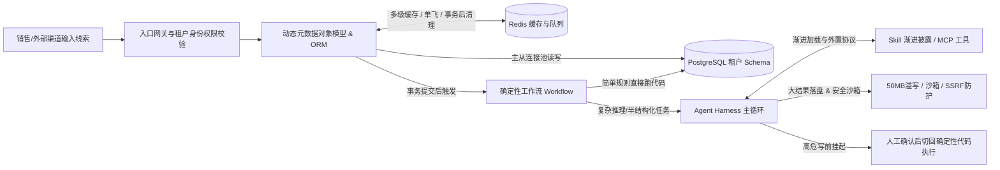

# 大纲 01 · 业务全貌与学习剪枝地图（第一阶：先看全貌）

> **阶段定位**：**先业务全貌**（三份大纲第一阶）  
> **适用岗位**：后端开发岗 & AI Agent 开发岗（**彻底剔除全栈与前端内容**）  
> **学习准则**：新手友好 · 大白话 + 生活化类比 · 重逻辑链与业务流转，轻生僻函数名与深层路径 · 全知识点按 2026 真实面试三层追问组织

---

## 本篇学习目标

1. 在 10 分钟内用大白话搞懂 **Twenty CRM 到底干什么、数据怎么流转**，不再被几万个源码文件吓住。
2. 拿到一份**精确到仓库模块体量的剪枝清单**：砍掉 90%+ 低复用率模块，把精力锁死在 **6 大高 ROI 心脏板块**。
3. 记住贯通全系列教程的 **「1 条企业获客跟进业务主线」**，看清它如何串起后续“后端瓶颈演进”和“Agent 系统设计”。

---

## 一、10 分钟大白话鸟瞰：Twenty 到底是什么系统？

- **生活化类比**：
  - **后端底座**就像一座 **“可随时自由拆装货架的共享写字楼物业平台”**：每家入驻公司（租户）拥有独立隔间（Schema 隔离），客户可以随时自己给“线索表”加字段而不需要物业重新盖楼（动态元数据建模 + 安全改表引擎）。
  - **Agent 运行时**就像一名 **“穿着全套安全护具干活的智能助理（Agent Harness）”**：不让大脑（大模型）乱碰真实保险柜，外面包着按需翻手册（Skill 渐进披露）、超大数据存档案室按页看（50MB 外置溢写）、断网自动接力（流式恢复）和危险操作弹窗等人拍板（HITL 挂起确认）。
- **核心架构与业务流转全景**：

---

## 二、给 3.4 万+ 文件做减法：高 ROI 必学板块 vs 明确跳过剪枝清单

基于本地 `twenty` 仓库真实模块统计（仅服务端 `twenty-server` 即有 **13,210** 个 TS 源文件，加上 `twenty-front` 11,145、`twenty-apps` 3,270、`twenty-ui` 1,658 等），新手**绝对不能从头看到尾**。

### 1. 直接一刀砍掉的 4 大噪音区（跳过 90%+ 代码量）

| 剪枝编号 | 被跳过的仓库板块（真实体量） | 为什么狠心跳过？ |
| :---: | :--- | :--- |
| 剪枝 A | **纯前端、UI 组件与官网插件包**（`twenty-front` 11,145 文件、`twenty-ui` 1,658、`twenty-front-component-renderer` 1,497、`twenty-website` 1,108、`twenty-apps` 3,270、`twenty-cli`/`twenty-emails` 等） | 明确不做全栈岗，React 表格拖拽、样式和官网页面对后端/Agent 面试帮助接近零 |
| 剪枝 B | **外围 CRM 细碎业务子模块**（`src/modules` 除 `workflow` 外的日历同步 `calendar` 162、收发邮件 `messaging`/`emailing` 435、看板 `dashboard` 112、`connected-account`、`blocklist` 等） | 高度耦合邮箱/日历第三方协议，属于业务逻辑泥潭，面试极少深挖 |
| 剪枝 C | **`core-modules` 周边非主干基础设施**（约 80 个杂项中的 `billing` 计费订阅、`cloudflare`、`dns-manager`、`captcha`、`i18n`、`short-link`、`sso`、`web-push`、`geo-map`、`onboarding` 等） | 属于 SaaS 商业化外围配件，20 份 2026 真题几乎零命中 |
| 剪枝 D | **历史脚本与纯界面配置元数据**（`src/database` 1,392 个历史迁移文件，以及 `metadata-modules` 中 `view`/`page-layout`/`navigation-menu-item`/`translation` 等展示配置表） | 看懂“动态改表引擎”思想即可，绝不去逐条翻历史 SQL 和菜单布局表 |

### 2. 提炼出的 6 大必学心脏板块（不到全仓 8% 视野，命中 20 份真题 ~85% 核心考点）

| 板块编号 | 必学心脏板块 | 对应仓库核心域（仅列顶层模块） | 命中岗位 | 锚定 2026 真题 | 所属后续大纲 |
| :---: | :--- | :--- | :--- | :--- | :---: |
| **板块 1** | **多租户隔离与数据访问引擎** | `engine/twenty-orm`、`engine/workspace-datasource`、`engine/api`、`dataloaders` | 后端核心 | `B01` `B05` `B06` `B07` | [大纲 02](大纲02-后端核心链路与瓶颈演进.md) |
| **板块 2** | **动态元数据建模与声明式安全改表引擎** | `metadata-modules/object-metadata`/`field-metadata`/`index-metadata`、`engine/workspace-manager`、`permissions` | 后端 + Agent | `B03` `B07` `A10` | [大纲 02](大纲02-后端核心链路与瓶颈演进.md) |
| **板块 3** | **多级缓存、锁机制与异步任务/工作流引擎** | `core-modules/cache-storage`/`cache-lock`/`message-queue`/`throttler`、`engine/workspace-cache`、`modules/workflow` | 后端 + Agent | `B01` `B02` `B04` `B05` `B06` `B08` `B09` `B10` `A03` | [大纲 02](大纲02-后端核心链路与瓶颈演进.md) |
| **板块 4** | **Agent Harness 主循环、50MB 大结果溢写与上下文控制** | `metadata-modules/ai`（`ai-agent-execution`/`ai-models`/`ai-billing`）、`core-modules/tool`/`tool-provider` | Agent + 后端 | `A01` `A02` `A04` `A06` `B08` | [大纲 03](大纲03-Agent系统设计与缺口补盲.md) |
| **板块 5** | **MCP 多模式接入、Skill 渐进披露与 HITL 人工挂起** | `metadata-modules/skill`/`mcp-server`、`core-modules/pending-wake-up` | Agent + 后端 | `B03` `B09` `A01` `A05` `A09` `A10` | [大纲 03](大纲03-Agent系统设计与缺口补盲.md) |
| **板块 6** | **流式断线恢复、并发抢占、安全沙箱与评测骨架** | `metadata-modules/ai`（`ai-chat` 流式恢复/取消、`ai-evaluation`）、`core-modules/code-interpreter`/`secure-http-client`/`sql-sanitization` | Agent + 后端 | `A01` `A05` `A07` `A08` `B06` | [大纲 03](大纲03-Agent系统设计与缺口补盲.md) |

---

## 三、贯通全书的「1 条核心业务主线」设计

用以下真实业务故事把上面 6 个板块死死串在一起——**学任何一章，都要能立刻指出它站在这条线的第几站**：

> **主线故事：《一条企业大客户线索从录入到 AI 安全跟进的全程》**
> 1. **第 1 站（进门隔离）**：某入驻企业销售录入一条“新客户线索”，平台先识别当前企业租户身份与角色权限，通过共享主从连接池把请求路由到该租户专属 Schema，并校验客户自定义的“预算/意向级别”字段，不串库、不 N+1 拖垮数据库。 *(→ 大纲 02 · 模块 1)*
> 2. **第 2 站（快读与安全改表）**：万一管理员刚给线索表新增了自定义字段，系统靠带锁超时保护和自动逆向回滚的声明式引擎悄悄改表不锁站；高频查询靠多级缓存 + 单飞合并扛住，事务提交完才统一删缓存和推消息。 *(→ 大纲 02 · 模块 1 & 2)*
> 3. **第 3 站（确定性工作流解耦）**：复杂线索分配与批量导入不堵在同步接口里，交由带租户限流和内存守护的异步队列跑；确定性的分配、打标规则由 `workflow` 按每 20 步主动让出执行权稳健推进。 *(→ 大纲 02 · 模块 2)*
> 4. **第 4 站（唤起 AI 助理并防爆窗）**：遇到需要归纳长背景材料或匹配历史沟通的模糊环节，工作流唤起 Agent Harness 主循环——首轮仅暴露轻量 Skill 目录摘要，按需加载工具；遇到工具一次性吐出几十 MB 原始资料，系统自动落盘外置只留小卡片给模型按需分页查，90% 上下文红线由 Harness 强制剪枝。 *(→ 大纲 03 · 模块 3)*
> 5. **第 5 站（断线续推与人工挂起安全门）**：销售看一半刷新网页，后端凭数据库状态 + 游标补发 + CAS 心跳抢占做到一字不丢、绝不双跑；如果助理读到外部夹带的恶意指令试图越权删库或访问内网，服务端策略网关、沙箱和 SSRF 防护硬拦下来；正常高危写动作则挂起弹窗，等销售点“确认”后立刻切回确定性代码落库。 *(→ 大纲 03 · 模块 4)*
> 6. **第 6 站（评测闭环与项目诚实边界）**：事后全程工具调用与 Token 消耗入账审计；同时清醒认识到“向量 RAG、跨会话长期语义记忆、多 Agent 协作、个人压测数值”属于 Twenty 当前边界之外的缺口，学会用标准化场景设计+真实二开来补齐。 *(→ 大纲 03 · 补盲包)*

---

## 四、整体重构映射与后续 `/asu-skills` 验收闭环

| 大纲阶段 | 核心结构定位（对应 `@[Quote]` 重构框架） | 学完后立刻用 `asu-training-seed.md` 验收哪些题？ |
| :--- | :--- | :--- |
| [大纲 01](大纲01-业务全貌与学习剪枝地图.md) | **1 条业务主线 + 剪枝总图**（业务全貌） | 自测能不能在 2 分钟内用大白话讲清主线 6 站，并说出“哪些模块不需要看、为什么” |
| [大纲 02](大纲02-后端核心链路与瓶颈演进.md) | **能力模块 1 + 能力模块 2**（瓶颈演进 · 后端主力 50%） | 调用 `/interview grill` 验收 **`seed-be-01` ~ `seed-be-10`** 及场景题 1、2 |
| [大纲 03](大纲03-Agent系统设计与缺口补盲.md) | **能力模块 3 + 能力模块 4 + 避坑二开补盲包**（系统设计 · Agent 主力 35% + 补盲 15%） | 调用 `/interview grill` 验收 **`seed-ag-01` ~ `seed-ag-10`** 及场景题 3、4 |

> **配套真题底座**：全部三层追问均直接关联 [面经种子库 README](../面经种子库/README.md) 与 [asu-training-seed.md](../面经种子库/asu-training-seed.md)。
